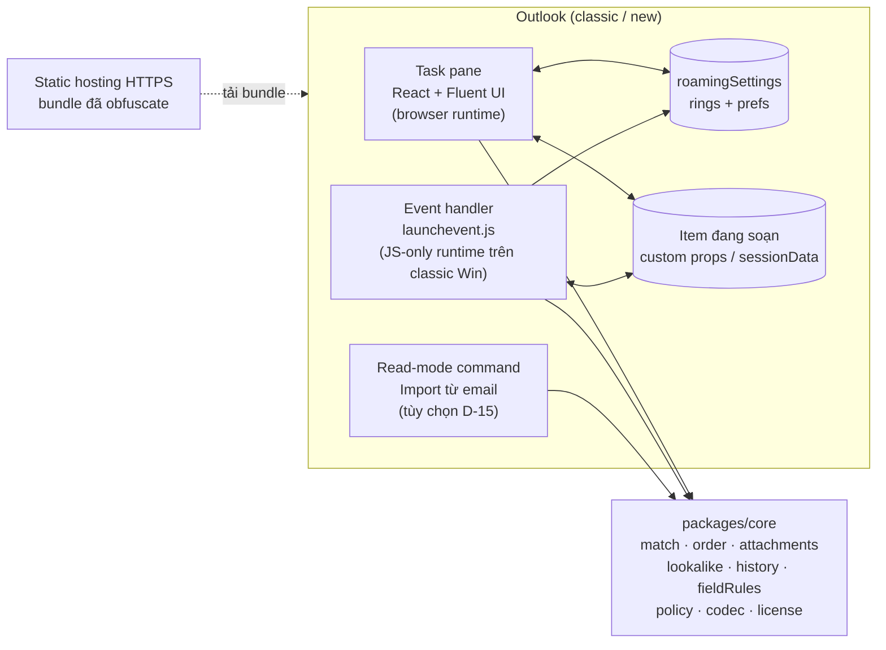
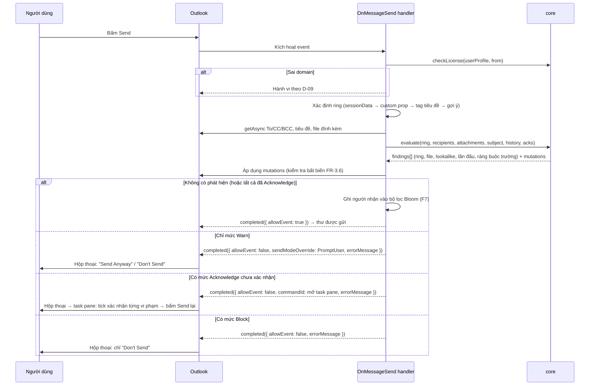

# Secure Mail Ring — Kế hoạch dự án

| Thuộc tính | Giá trị |
|---|---|
| Phiên bản tài liệu | **v0.2 — Bản nháp, đã chốt một phần quyết định** |
| Ngày | 2026-10-29 |
| Chủ sở hữu | Product Owner (người yêu cầu) |
| Trạng thái | Đã chốt D-01, D-02, D-03, D-04, D-12 và phạm vi F6–F8. Còn mở D-05 → D-11, D-13 → D-15 (§12) trước khi khóa phạm vi (Stage 0 gate) |
| Quy ước | `FR-x.y` = yêu cầu chức năng · `NFR-x` = phi chức năng · `D-xx` = quyết định cần duyệt · `R-xx` = rủi ro · **[Verify-S0]** = giả định kỹ thuật phải được kiểm chứng ở Stage 0 trước khi xây dựng tiếp |

> Nguyên tắc làm việc: mỗi stage đi theo chuỗi **Scope → Draft → Validate/Test → Sign-off → Package**. Không stage nào bắt đầu khi gate của stage trước chưa được ký duyệt. Mọi thông số API Office.js trong tài liệu này được ghi theo hiểu biết hiện tại và **phải xác minh trên đúng build Outlook của người dùng** ở Stage 0 — không xây trên giả định chưa kiểm chứng.

### Lịch sử phiên bản

| Phiên bản | Ngày | Thay đổi |
|---|---|---|
| v0.1 | 2026-10-29 | Bản nháp đầu tiên |
| v0.2 | 2026-10-29 | Chốt D-01 (M365 Exchange Online), D-02 (classic + new Outlook), D-03 (**không có quyền admin → người dùng tự cài manifest**, để ngỏ đường admin center), D-04 (mặc định Warn + tùy chọn strict), D-12 (Tầng 2, chừa Tầng 3). Bỏ link/trang import → **mã cấu hình dán trực tiếp**. Đưa E-1, E-2, E-4 vào v1 thành **F6** (domain gần giống), **F7** (người nhận lần đầu), **F8** (ràng buộc trường). Thêm mô hình xử lý vi phạm 3 mức Warn / Acknowledge / Block. Hiệu chỉnh effort |

---

## 1. Tóm tắt điều hành

**Vấn đề.** Gửi nhầm người nhận (autocomplete, reply-all, forward) và đính kèm nhầm file của khách hàng/dự án khác là nguồn rò rỉ dữ liệu phổ biến nhất trong môi trường tư vấn – kiểm toán. Outlook không có kiểm soát gốc theo "nhóm giao dịch" (engagement).

**Giải pháp.** Một Outlook add-in kiểm soát **tại thời điểm bấm Send** (preventive, automated control) dựa trên khái niệm **Mail Ring** — một hồ sơ cấu hình cho từng engagement gồm: danh sách người nhận hợp lệ (địa chỉ cụ thể và/hoặc domain), tag tiêu đề, quy tắc sắp xếp To/CC/BCC, và ký hiệu bắt buộc trên tên file đính kèm. Cấu hình có thể chia sẻ nội bộ qua một **mã cấu hình đã mã hóa** (copy–paste để import); add-in chỉ hoạt động với domain được nhúng khi build. Bổ sung ba lớp phát hiện: domain giả mạo gần giống (F6), người nhận lần đầu (F7), ràng buộc vai trò To/CC/BCC (F8).

**Khuyến nghị nền tảng.** **Office Web Add-in (Office.js) + Smart Alerts (`OnMessageSend`)**, viết bằng TypeScript. Đây là công nghệ duy nhất chạy được trên cả *classic Outlook for Windows* và *new Outlook for Windows* (new Outlook **không** hỗ trợ COM/VSTO). Chi tiết so sánh tại §4.

**Ước lượng sơ bộ.** 8 stage (S0–S7), khoảng **39–59 ngày công** cho 1 developer (đã gồm F6–F8), tùy kết quả Stage 0 và các quyết định còn mở ở §12. Chi phí công cụ: **0 đồng** (toàn bộ công cụ miễn phí/mã nguồn mở; hosting dùng free tier).

**Ba điểm cần nói thẳng ngay từ đầu:**

1. **Nền tảng khả thi; ràng buộc chính là không có quyền admin.** Hộp thư là Microsoft 365 Exchange Online (D-01), nên Office Web Add-in chạy được. Vì không triển khai qua admin center (D-03), **người dùng tự cài add-in từ file manifest (sideload)**. Hai hệ quả: (a) tenant phải cho phép người dùng cài custom add-in — kiểm tra **ngay ngày đầu Stage 0**, vì nếu bị chặn thì phương án không-admin không chạy được; (b) mỗi lần đổi manifest, mọi người dùng phải cài lại → **manifest v1 phải khai báo đủ mọi event, nút và quyền ngay từ đầu**.
2. **Code add-in là JavaScript chạy ở client, được tải từ URL công khai.** Obfuscation miễn phí chỉ *tăng chi phí* dịch ngược, không *ngăn* được. v1 áp dụng **Tầng 2** (D-12). Kiểm soát mạnh thực sự — xác thực tenant bằng token Entra ID (Tầng 3) — được chừa sẵn điểm tích hợp (§6.3).
3. **Kiểm tra theo tên file là kiểm soát có giới hạn thiết kế.** Nó bắt được "file của ring khác" và "file chưa gắn ký hiệu", nhưng **không** bắt được file sai nội dung mà đặt đúng tên. Giới hạn này cần được ghi nhận khi trình bày control cho người dùng cuối.

---

## 2. Mục tiêu kiểm soát & phạm vi

### 2.1 Ánh xạ tính năng → mục tiêu kiểm soát

| ID | Mục tiêu kiểm soát | Tính năng | Loại kiểm soát | Giới hạn thiết kế (ghi nhận) |
|---|---|---|---|---|
| CO-1 | Ngăn gửi email đến người ngoài nhóm được phép của engagement | F1 — Mail Ring & kiểm tra người nhận | Preventive, automated, point-of-send | Người dùng có thể override cảnh báo mức *warn*; Distribution List không được bung thành viên |
| CO-2 | Ngăn đính kèm file của engagement khác | F4 — Ký hiệu tên file | Preventive, automated | Chỉ kiểm tra **tên**; không kiểm tra nội dung/metadata (theo yêu cầu) |
| CO-3 | Cấu hình nhất quán giữa các thành viên nhóm | F2 — Chia sẻ cấu hình | Configuration management | Bản import là bản sao; không đồng bộ thời gian thực |
| CO-4 | Tăng khả năng tự rà soát người nhận trước khi gửi | F3 — Sắp xếp To/CC/BCC | Hỗ trợ kiểm soát (supports human review) | Chỉ đổi **thứ tự**, không chuyển người nhận giữa To/CC/BCC |
| CO-5 | Giới hạn công cụ cho tổ chức được cấp phép; hạn chế dịch ngược | F5 — Domain lock & hardening | Access restriction / anti-tamper | Kiểm tra phía client có thể bị vượt qua bởi người có kỹ năng (§6.3) |
| CO-6 | Phát hiện domain giả mạo gần giống domain hợp lệ (BEC, typosquatting) | F6 — Lookalike domain | Preventive, automated, point-of-send | Dựa trên thuật toán tương đồng; không thay thế xác minh ngoài kênh (call-back) |
| CO-7 | Phát hiện người nhận chưa từng liên lạc (lỗi autocomplete) | F7 — Người nhận lần đầu | Detective tại điểm gửi | Lịch sử chỉ tính từ lúc cài add-in; bộ lọc xác suất bỏ sót ~1% |
| CO-8 | Đảm bảo đúng vai trò người nhận (ai phải ở CC, ai không được ở BCC) — lines of accountability trong giao tiếp | F8 — Ràng buộc trường | Preventive | Chỉ cảnh báo, không tự di chuyển người nhận |

### 2.2 Trong phạm vi

- Outlook for Windows: **classic Outlook (Microsoft 365 Apps)** và **new Outlook for Windows**.
- Soạn thư mới, Reply, Reply All, Forward, mở lại bản nháp.
- Ring quản lý cá nhân (per-mailbox), chia sẻ thủ công qua mã cấu hình (copy–paste).
- **Người dùng tự cài** (sideload file manifest), không cần quyền admin.
- Build pipeline có nhúng domain và obfuscation.
- F6–F8: domain gần giống, người nhận lần đầu, ràng buộc trường.

### 2.3 Ngoài phạm vi (v1)

| Mục | Lý do |
|---|---|
| Quét nội dung/metadata file đính kèm, DLP | Theo yêu cầu; trùng chức năng Microsoft Purview |
| Outlook Mobile (iOS/Android) | Hỗ trợ event-based/Smart Alerts trên mobile hạn chế **[Verify-S0]** |
| Outlook for Mac, Outlook on the web | Về kỹ thuật gần như "miễn phí" vì cùng code base — đề xuất đưa vào test matrix mức *best effort* (D-02) |
| Đồng bộ ring tập trung qua server, quản trị ring theo tenant | Cần backend; đề xuất cho v2 (§11) |
| Hộp thư IMAP/POP | Office add-in không hỗ trợ; không áp dụng (D-01: M365) |
| Triển khai qua Microsoft 365 admin center | Không có quyền admin (D-03). Kiến trúc giữ nguyên đường mở rộng: cùng manifest đó triển khai được qua Integrated Apps, không phải đổi code (§9) |
| Link import / trang web import | Thay bằng mã cấu hình dán trực tiếp (v0.2) |

---

## 3. Yêu cầu chi tiết

### F1 — Mail Ring và kiểm tra người nhận

**User story.** *Là người gửi, tôi chọn Mail Ring cho email đang soạn; khi bấm Send, add-in cảnh báo nếu có người nhận nằm ngoài ring.*

| ID | Yêu cầu |
|---|---|
| FR-1.1 | Tạo/sửa/xóa/nhân bản ring: tên, **tag tiêu đề** (ví dụ `[ALPHA]`), danh sách thành viên |
| FR-1.2 | Thành viên là **địa chỉ cụ thể** (`cfo@abccorp.vn`), **domain chính xác** (`abccorp.vn`) hoặc **domain kèm subdomain** (`*.abccorp.vn`) — ba loại tách biệt, không suy diễn ngầm |
| FR-1.3 | Trong cửa sổ soạn thư: chọn ring từ danh sách (task pane). Khi chọn, add-in chèn tag vào đầu tiêu đề nếu chưa có |
| FR-1.4 | Ring của email được ghi bền vào item (custom property + `sessionData`) và có thể ghi X-header `X-MailRing-Id` để truy vết |
| FR-1.5 | Reply/Forward tự nhận diện ring từ tag tiêu đề hoặc custom property của thư gốc |
| FR-1.6 | Khi Send: kiểm tra **To + CC + BCC**; liệt kê từng người ngoài ring trong thông báo Smart Alerts |
| FR-1.7 | Chính sách domain nội bộ (domain của người gửi): *allow* / *warn* / *treat as outsider* — cấu hình theo từng ring (D-07) |
| FR-1.8 | Không chọn ring: hành vi theo D-05 (đề xuất: gợi ý ring khớp nhất theo người nhận; cảnh báo nếu có người nhận ngoài domain nội bộ) |
| FR-1.9 | Cảnh báo theo thời gian thực khi đang soạn (thanh thông báo trong item) qua sự kiện thay đổi người nhận — không chặn, chỉ báo trước |

**Quy tắc nghiệp vụ & edge case**

- Chuẩn hóa địa chỉ: `trim`, lowercase, chuẩn hóa Unicode NFC, domain quốc tế chuyển **punycode** trước khi so khớp (chống homograph `аbccorp.vn` dùng chữ Cyrillic).
- `abccorp.vn` **không** khớp `mail.abccorp.vn` trừ khi khai báo `*.abccorp.vn`. `*.abccorp.vn` không khớp `abccorp.vn.attacker.com` (so khớp theo nhãn domain từ phải sang trái, không phải substring).
- Distribution List / nhóm M365: add-in chỉ thấy địa chỉ nhóm, không thấy thành viên → nhóm phải được khai báo **đích danh** trong ring; không suy ra hợp lệ từ domain (D-08).
- Người nhận chưa resolve (chỉ có display name): coi là ngoài ring.

**Acceptance criteria (mẫu):** Ring `ALPHA` = {`abccorp.vn`, `kt@partner.vn`}; email gửi To `a@abccorp.vn`, CC `kt@partner.vn`, BCC `x@gmail.com` → Smart Alert liệt kê đúng 1 người: `x@gmail.com (BCC)`.

### F2 — Chia sẻ cấu hình qua mã cấu hình đã mã hóa

| ID | Yêu cầu |
|---|---|
| FR-2.1 | Xuất 1 ring thành **mã cấu hình** (JSON → nén deflate → mã hóa AES-GCM → base64url), đặt giữa hai dòng đánh dấu `-----BEGIN MAILRING-----` / `-----END MAILRING-----` |
| FR-2.2 | Bộ giải mã bỏ qua khoảng trắng và xuống dòng → mã vẫn dùng được khi email client tự ngắt dòng hoặc khi copy qua Teams/Zalo |
| FR-2.3 | Sau khi lưu ring, tùy chọn "Chia sẻ cho đồng nghiệp": add-in mở một email mới (`displayNewMessageForm`) điền sẵn người nhận là **các địa chỉ cụ thể thuộc domain nội bộ** trong ring; thân thư chứa mã + hướng dẫn 3 bước. Người dùng xem lại rồi tự bấm Send |
| FR-2.4 | **Chặn chia sẻ ra ngoài domain nội bộ** (rule engine kiểm tra chính email chia sẻ) — cấu hình ring là danh sách khách hàng, bản thân nó là thông tin mật |
| FR-2.5 | **Import:** Settings → "Nhập mã cấu hình" → dán → add-in giải mã, validate schema, hiển thị **bản xem trước + diff** → bấm *Import* |
| FR-2.6 | Diff làm nổi bật thay đổi rủi ro: địa chỉ/domain **mới** được thêm, domain ngoài, chính sách bị **nới lỏng** (Block → Warn) |
| FR-2.7 | Phiên bản hóa: mỗi ring có `id` + `rev`. Import trùng `id` với `rev` mới hơn → cập nhật sau khi xem diff; `rev` cũ hơn → từ chối, báo rõ |
| FR-2.8 | Mã mang theo `issuer` (email người tạo) và `issuedAt`, hiển thị trong preview; hạn dùng của mã là tùy chọn |

**Đánh đổi của import bằng dán mã (ghi nhận).** So với import từ email, dán mã mất khả năng kiểm tra nguồn gửi (DKIM/DMARC). Các neo tin cậy còn lại: (1) chỉ add-in build cho đúng tổ chức mới giải mã được (khóa nhúng lúc build); (2) AES-GCM phát hiện mọi chỉnh sửa trên mã; (3) diff preview buộc người dùng nhìn thấy thay đổi trước khi chấp nhận. Người ngoài muốn tạo mã giả phải trích được khóa từ bundle đã obfuscate — chi phí cao so với lợi ích. **Tùy chọn D-15:** thêm nút "Import từ email này" ở chế độ đọc thư để khôi phục kiểm tra nguồn gửi. Nếu muốn có, nút này phải được khai báo ngay trong manifest v1, tránh buộc người dùng cài lại sau này.

### F3 — Sắp xếp người nhận To/CC/BCC

| ID | Yêu cầu |
|---|---|
| FR-3.1 | Mỗi ring có 3 danh sách thứ tự (To, CC, BCC); mỗi phần tử là địa chỉ cụ thể hoặc domain, **trộn lẫn tùy ý**, kéo-thả để sắp xếp |
| FR-3.2 | Quy tắc xếp hạng: người nhận lấy hạng = vị trí của **mẫu đầu tiên khớp** trong danh sách (WYSIWYG — đọc từ trên xuống) |
| FR-3.3 | Người nhận không khớp mẫu nào: xếp sau cùng, **giữ nguyên thứ tự gốc** (stable sort); có thể đặt mẫu `*` để chỉ định vị trí của nhóm "còn lại" |
| FR-3.4 | UI cảnh báo **mẫu bị che khuất**: ví dụ `abccorp.vn` đứng trước `cfo@abccorp.vn` thì mẫu sau không bao giờ được dùng (cùng bài học "longest/most-specific match" đã gặp ở dự án CPE) |
| FR-3.5 | Thời điểm sắp xếp: khi Send (tự động) + nút "Sắp xếp ngay" trong task pane để người dùng thấy kết quả trước (D-06) |
| FR-3.6 | **Bất biến an toàn:** tập người nhận (multiset địa chỉ + display name + trường To/CC/BCC) trước và sau khi sắp xếp phải giống hệt. Nếu khác hoặc `setAsync` lỗi → hủy sắp xếp, giữ nguyên, ghi log; **không bao giờ chặn gửi chỉ vì lỗi sắp xếp** |

### F4 — Ký hiệu bắt buộc trên tên file đính kèm

| ID | Yêu cầu |
|---|---|
| FR-4.1 | Mỗi ring có tập **token** cho tên file (ví dụ `ALPHA`, `ABC-IA`) |
| FR-4.2 | Khi Send: mỗi file đính kèm (không phải inline) phải chứa **ít nhất một** token của ring hiện tại (chế độ *any*; chế độ *all*/regex để mở rộng sau) |
| FR-4.3 | **Kiểm tra chéo ring:** tên file chứa token của **ring khác** (mà không chứa token của ring hiện tại) → mức nghiêm trọng cao nhất. Đây là tín hiệu gửi nhầm mạnh nhất |
| FR-4.4 | So khớp token **theo ranh giới** (boundary-aware), không phải substring: `ABC` không khớp `ABCD_Report.xlsx`. Ranh giới = đầu/cuối chuỗi hoặc ký tự không phải chữ-số (`_ - . [ ] ( ) space`) |
| FR-4.5 | Không phân biệt hoa thường; chuẩn hóa NFC; tùy chọn bỏ dấu tiếng Việt khi so khớp |
| FR-4.6 | Ngoại lệ cấu hình được: ảnh inline (chữ ký), phần mở rộng `.ics`, `.vcf` |
| FR-4.7 | Loại đính kèm: file thường, item đính kèm (`.msg` — tên = tiêu đề thư), cloud attachment (OneDrive/SharePoint link) — đều kiểm tra theo tên |
| FR-4.8 | Chỉ đọc **tên** qua `getAttachmentsAsync`; không đọc nội dung (đúng yêu cầu, đồng thời giảm quyền cần cấp) |

### F5 — Domain lock khi build & tăng cường chống dịch ngược

| ID | Yêu cầu |
|---|---|
| FR-5.1 | Danh sách domain được phép (`ALLOWED_SENDER_DOMAINS`) được **nhúng lúc build** từ biến môi trường/secret CI, không nằm trong repo |
| FR-5.2 | Runtime kiểm tra domain của `userProfile.emailAddress` **và** của trường `From` trong thư đang soạn (bắt trường hợp gửi từ shared mailbox/delegate) |
| FR-5.3 | Sai domain → task pane hiển thị màn hình từ chối ("Add-in không được cấp phép cho hộp thư này"); handler Send xử lý theo D-09 |
| FR-5.4 | Pipeline hardening miễn phí: minify, obfuscation, khóa origin hosting, tắt source map production, CSP (chi tiết §6.4) |
| FR-5.5 | (Chừa sẵn cho Tầng 3) Xác thực tenant bằng token Entra ID qua backend free tier — §6.3 |
| FR-5.6 | Vì phân phối bằng file manifest (sideload), manifest được build riêng cho từng tổ chức và chỉ trỏ tới origin hosting đã khóa. Manifest có bị phát tán ra ngoài thì vẫn vô dụng với hộp thư khác domain (FR-5.2) |

### F6 — Cảnh báo domain gần giống (lookalike) — *E-1, đã duyệt*

| ID | Yêu cầu |
|---|---|
| FR-6.1 | So domain của từng người nhận với **tập domain tham chiếu**: domain trong ring hiện tại + domain nội bộ + domain của mọi ring khác |
| FR-6.2 | Bỏ qua khớp chính xác. Cảnh báo khi: (a) khoảng cách Damerau-Levenshtein ≤ 1 (nhãn chính ≤ 8 ký tự) hoặc ≤ 2 (dài hơn); (b) trùng *skeleton* sau khi quy đổi ký tự dễ nhầm (`0→o`, `1→l`, `rn→m`, `vv→w`, homoglyph Unicode theo UTS #39); (c) cùng nhãn chính nhưng khác hậu tố (`abccorp.vn` ↔ `abccorp.com.vn` ↔ `abccorp.com`); (d) thêm/bớt dấu gạch (`abc-corp.vn`) |
| FR-6.3 | Thông điệp nêu rõ cặp so sánh: "`abcc0rp.vn` rất giống `abccorp.vn` (ring ALPHA)" |
| FR-6.4 | Danh sách ngoại lệ do người dùng xác nhận (cặp domain hợp lệ thật sự giống nhau) |
| FR-6.5 | Chạy **cả khi không chọn ring** (so với domain nội bộ + mọi ring) — kiểm soát chống BEC độc lập với Mail Ring |

### F7 — Cảnh báo người nhận lần đầu — *E-2, đã duyệt*

| ID | Yêu cầu |
|---|---|
| FR-7.1 | Ghi nhận các địa chỉ đã gửi vào một **bộ lọc Bloom** (≈ 4 KB, ~3.000 địa chỉ ở tỷ lệ dương tính giả 1%) lưu trong `roamingSettings`. Chỉ lưu hash có salt, không lưu địa chỉ rõ |
| FR-7.2 | Khi Send: người nhận chưa có trong bộ lọc **và** không được khai báo đích danh trong ring → cảnh báo "lần đầu gửi tới địa chỉ này". Thành viên khai báo đích danh trong ring được coi là đã biết |
| FR-7.3 | Khởi động lạnh: chế độ học trong N ngày đầu (mặc định 14) chỉ ghi nhận, không cảnh báo; tùy chọn dán nhanh danh sách địa chỉ đã biết |
| FR-7.4 | Khi bộ lọc vượt ngưỡng lấp đầy → xoay vòng (giữ 2 thế hệ) để tỷ lệ dương tính giả không tăng dần |
| FR-7.5 | Thời điểm ghi nhận: khi handler cho phép gửi (`allowEvent: true`), kể cả lần gửi lại sau khi đã Acknowledge. Trường hợp người dùng bấm "Send Anyway" ở mức Warn, add-in có thể không nhận được tín hiệu nào sau đó **[Verify-S0]** → dự phòng: ghi nhận ngay khi đánh giá, với các địa chỉ đã hiển thị cảnh báo |
| FR-7.6 | Có thể tắt theo từng ring |

Ghi nhận: dương tính giả của Bloom nghĩa là ~1% địa chỉ mới bị coi là "đã biết" → bỏ sót cảnh báo (lệch về phía ít cảnh báo, không bao giờ chặn nhầm). Lịch sử chỉ có từ lúc cài add-in; **không** đọc Sent Items vì sẽ cần quyền `ReadWriteMailbox`, trái NFR-4.

### F8 — Ràng buộc trường To/CC/BCC — *E-4, đã duyệt*

| ID | Yêu cầu |
|---|---|
| FR-8.1 | Mỗi ring có danh sách ràng buộc. Mỗi ràng buộc gồm *mẫu* (địa chỉ/domain), *trường* và *loại*: `mustBeIn` (phải có mặt ở trường X — ví dụ partner luôn ở CC), `mustNotBeIn` (không được ở trường X — ví dụ khách hàng không bao giờ ở BCC), `onlyIn` (nếu có mặt thì chỉ được ở X) |
| FR-8.2 | `mustBeIn` có thể kèm điều kiện kích hoạt: chỉ áp dụng khi email có người nhận ngoài domain nội bộ |
| FR-8.3 | Chỉ cảnh báo, **không tự di chuyển** người nhận giữa các trường (nhất quán với F3). Task pane có nút "Sửa nhanh" để người dùng chủ động áp dụng |
| FR-8.4 | Phát hiện ràng buộc mâu thuẫn ngay khi lưu ring (ví dụ `mustBeIn CC` và `mustNotBeIn CC` cho cùng một mẫu) |

### Mô hình xử lý vi phạm — áp dụng chung (D-04, đã chốt)

| Mức | Hành vi khi Send | Cơ chế Smart Alerts |
|---|---|---|
| **Warn** (mặc định) | Hộp thoại liệt kê từng vi phạm; người dùng phải chủ động bấm **"Send Anyway"** để xác nhận override | `sendModeOverride: PromptUser` |
| **Acknowledge** (strict) | Không gửi ngay. Nút trên hộp thoại mở task pane; người dùng tick xác nhận **từng vi phạm** rồi bấm Send lại. Xác nhận gắn với dấu vân tay (hash) của tập người nhận + tên file → thay đổi bất kỳ thì phải xác nhận lại | SoftBlock + `commandId` mở task pane; xác nhận lưu trong `sessionData` **[Verify-S0]** |
| **Block** (strict nhất) | Không gửi được cho đến khi sửa | SoftBlock, không cho override |

- Mức được đặt cho **từng loại vi phạm trong từng ring**: người ngoài ring, file thiếu token, file mang token ring khác, domain gần giống, người nhận lần đầu, vi phạm ràng buộc trường. Mặc định tất cả là **Warn**.
- Settings có **mức sàn toàn cục**: ví dụ "mọi ring tối thiểu Acknowledge cho file mang token ring khác". Ring không thể đặt thấp hơn mức sàn, và mã cấu hình import cũng không hạ được mức sàn.
- Preset **Strict** cho engagement nhạy cảm (một chạm): người ngoài ring → Acknowledge; token ring khác → Block; domain gần giống → Block; còn lại → Acknowledge.
- Thiếu tag tiêu đề: tự chèn, không phải vi phạm.

### Yêu cầu phi chức năng

| ID | Yêu cầu |
|---|---|
| NFR-1 | Kiểm tra khi Send (gồm F1, F3, F4, F6–F8) hoàn tất < 1,5 giây cho email ≤ 50 người nhận, ≤ 20 file (đo ở Stage 4) |
| NFR-2 | Fail-safe: lỗi nội bộ của add-in **không được** làm mất email hoặc treo Outlook; hành vi khi add-in không tải được do manifest quyết định (SoftBlock — §5.4) |
| NFR-3 | Không gửi dữ liệu email ra ngoài Outlook (trừ Tầng 3 nếu chọn: chỉ gửi token định danh, không gửi nội dung) |
| NFR-4 | Quyền tối thiểu trong manifest: `ReadWriteItem` (không xin `ReadWriteMailbox`) |
| NFR-5 | Song ngữ UI Việt/Anh (i18n từ đầu, chi phí thấp nếu làm sớm) |
| NFR-6 | Core logic là module thuần TypeScript, không phụ thuộc Office.js, độ phủ unit test ≥ 90% |

---

## 4. Nền tảng công nghệ

### 4.1 So sánh phương án

| Tiêu chí | **Office Web Add-in (Office.js)** ✅ | VSTO (C#/.NET Framework) | COM add-in (C++/C#) |
|---|---|---|---|
| Classic Outlook for Windows | Có (Microsoft 365 Apps, build đủ mới) | Có | Có |
| **New Outlook for Windows** | **Có** | **Không** | **Không** |
| OWA / Mac | Có (cùng code) | Không | Không |
| Chặn/cảnh báo khi Send | Smart Alerts `OnMessageSend` | `Application.ItemSend` (rất mạnh) | `ItemSend` |
| Sắp xếp người nhận | `to/cc/bcc.setAsync` **[Verify-S0 trong ngữ cảnh OnMessageSend]** | Toàn quyền object model | Toàn quyền |
| Đọc tên file đính kèm | `getAttachmentsAsync` | Có | Có |
| Triển khai | Manifest + hosting HTTPS; admin center hoặc sideload | MSI/ClickOnce, cần cài đặt trên máy | Đăng ký registry, cài đặt máy |
| Chống dịch ngược (công cụ miễn phí) | Yếu (JS) — obfuscator | Trung bình (.NET IL dễ decompile; ConfuserEx miễn phí nhưng đã ngừng phát triển) | Tốt nhất (native) |
| Hướng đi của Microsoft | **Chiến lược chính thức** | Duy trì, không phát triển; không có tương lai trên new Outlook | Như VSTO |

**Khuyến nghị: Office Web Add-in.** VSTO cho kiểm soát mạnh hơn trên classic Outlook nhưng là ngõ cụt khi tổ chức chuyển sang new Outlook — một kiểm soát mất hiệu lực khi người dùng bật công tắc "Try the new Outlook" là thiết kế không bền vững. Đổi lại, ta chấp nhận khả năng chống dịch ngược yếu hơn và bù bằng kiểm soát triển khai (§6).

### 4.2 Stack đề xuất

| Lớp | Lựa chọn | Lý do |
|---|---|---|
| Ngôn ngữ | TypeScript (strict) | An toàn kiểu cho rule engine |
| Scaffold | Yeoman `generator-office` (Outlook, TypeScript) | Công cụ chính thức, miễn phí |
| Manifest | **XML add-in-only manifest**; lộ trình sang unified JSON manifest khi có quyền admin | Cách người dùng tự cài ("Add from file") trên classic Outlook nhận file XML **[Verify-S0]** |
| Bundler | webpack (mặc định của template) | Tích hợp `webpack-obfuscator` |
| UI task pane | React 18 + **Fluent UI React v9** | Giao diện đồng bộ Outlook |
| Rule engine | Package thuần `packages/core` — không import Office.js | Test trên Node, tái sử dụng cho mọi runtime |
| Validation schema | `valibot` hoặc `zod` | Kiểm tra cấu hình import (dữ liệu không tin cậy) |
| Nén | `fflate` | Nhẹ, thuần JS, chạy được trong JS-only runtime |
| Mã hóa mã cấu hình | WebCrypto (AES-GCM) — chỉ trong task pane | Không phụ thuộc thư viện ngoài |
| Test | Vitest + `office-addin-mock` | Nhanh, không cần cài Outlook cho unit test |
| Lint | ESLint + `eslint-plugin-office-addins` + Prettier | Bắt lỗi API Office phổ biến |
| Obfuscation | `javascript-obfuscator` (qua `webpack-obfuscator`) | Miễn phí, mã nguồn mở |
| Hosting | Cloudflare Pages / GitHub Pages / Azure Static Web Apps (free tier) | Chỉ cần HTTPS tĩnh (D-03) |
| CI/CD | GitHub Actions | Lint → test → build → obfuscate → validate manifest → deploy |
| Debug | `office-addin-debugging`, Edge DevTools (WebView2), runtime logging của event-based add-in trên Windows | |

### 4.3 Ánh xạ tính năng → API Office.js

Requirement set ghi theo tài liệu Microsoft hiện hành — **toàn bộ cột này là [Verify-S0]**.

| Tính năng | API | Requirement set |
|---|---|---|
| Chặn/cảnh báo khi Send | Event `OnMessageSend` (Smart Alerts), `event.completed({ allowEvent, errorMessage })` | Mailbox 1.12 |
| Tùy biến nút/ chế độ override theo từng lần; mở task pane từ hộp thoại (mức Acknowledge) | `sendModeOverride`, `cancelLabel`, `commandId` | Mailbox 1.14 |
| Thông báo dạng Markdown | `errorMessageMarkdown` | Mailbox 1.15 |
| Cảnh báo khi đang soạn | Events `OnMessageRecipientsChanged`, `OnMessageAttachmentsChanged`; `item.notificationMessages` | Mailbox 1.11 |
| Tự gán ring cho Reply/Forward | Event `OnNewMessageCompose` | Mailbox 1.10 |
| Đọc/ghi người nhận | `item.to / cc / bcc` `getAsync` / `setAsync` | Mailbox 1.1 |
| Đọc/ghi tiêu đề | `item.subject` `getAsync` / `setAsync` | Mailbox 1.1 |
| Tên file đính kèm (compose) | `item.getAttachmentsAsync` | Mailbox 1.8 |
| Lưu ring đã chọn vào item | `loadCustomPropertiesAsync`; `item.sessionData` | 1.1; 1.11 |
| X-header truy vết | `item.internetHeaders.setAsync` | Mailbox 1.8 |
| Người gửi | `mailbox.userProfile.emailAddress`; `item.from.getAsync` | 1.1; 1.7 |
| Lưu cấu hình ring | `Office.context.roamingSettings` (giới hạn ~32 KB, đồng bộ theo hộp thư) | Mailbox 1.1 |
| Mở email chia sẻ cấu hình | `mailbox.displayNewMessageForm` | Mailbox 1.6 |
| (Tùy chọn D-15) Import từ email + kiểm tra header xác thực | `item.body.getAsync`; `item.getAllInternetHeadersAsync` | 1.3; 1.8 |

---

## 5. Kiến trúc

### 5.1 Thành phần



**Ràng buộc kiến trúc quan trọng:** trên classic Outlook for Windows, event handler chạy trong **JavaScript-only runtime** — không có DOM, không có React, tập API hạn chế. Vì vậy:

- `launchevent.js` là một bundle **riêng**, chỉ import `packages/core` + `fflate`; không import UI.
- Event handler **không** cần giải mã AES: cấu hình trong `roamingSettings` được lưu ở dạng đã giải mã (chỉ nén), vì nó đã nằm trong chính hộp thư của người dùng. Mã hóa chỉ áp dụng cho mã cấu hình chia sẻ (đi qua email/chat).

### 5.2 Luồng khi bấm Send



### 5.3 Mô hình dữ liệu

```jsonc
{
  "schema": "smr/1",
  "id": "01JBX4Q8...",            // ULID, bất biến
  "rev": 3,                        // tăng mỗi lần sửa
  "name": "Alpha – IA ABC Corp FY26",
  "subjectTag": "[ALPHA]",
  "owner": "tunt@tunt.pro",
  "updatedAt": "2026-10-29T08:00:00Z",
  "members": [
    { "kind": "address", "value": "cfo@abccorp.vn" },
    { "kind": "domain",  "value": "abccorp.vn" },
    { "kind": "subdomains", "value": "abccorp.vn" }     // = *.abccorp.vn
  ],
  "internalDomain": "allow",                            // allow | warn | outsider
  "order": {
    "to":  ["cfo@abccorp.vn", "abccorp.vn", "*"],
    "cc":  ["partner@tunt.pro", "tunt.pro", "*"],
    "bcc": []
  },
  "attachments": {
    "tokens": ["ALPHA", "ABC-IA"],
    "mode": "any",
    "ignoreInline": true,
    "exemptExtensions": [".ics", ".vcf"]
  },
  "policy": {                                           // warn | acknowledge | block — không thấp hơn mức sàn toàn cục
    "outsider": "warn",
    "missingToken": "warn",
    "foreignRingToken": "warn",
    "lookalike": "warn",
    "firstTime": "warn",
    "fieldRule": "warn"
  },
  "fieldRules": [
    { "pattern": "partner@tunt.pro", "type": "mustBeIn",    "field": "cc",  "when": "anyExternal" },
    { "pattern": "abccorp.vn",       "type": "mustNotBeIn", "field": "bcc" }
  ],
  "firstTimeCheck": true,
  "expiresAt": null                                     // engagement kết thúc → ring chuyển sang lưu trữ (E-8)
}
```

### 5.4 Chiến lược lưu trữ và hành vi khi lỗi

| Dữ liệu | Nơi lưu | Ghi chú |
|---|---|---|
| Danh sách ring + tùy chọn | `roamingSettings`, nén `fflate` | Ngân sách ~24 KB (xem bảng dưới) ≈ 20–40 ring sau nén **[Verify-S0 dung lượng thực]**. Vượt ngưỡng → D-10 |
| Lịch sử người nhận (F7) | `roamingSettings`, bộ lọc Bloom ~4 KB | Chỉ hash có salt |
| Ngoại lệ lookalike (F6), mức sàn, tùy chọn | `roamingSettings` | ~2 KB |
| Ring của email đang soạn | `sessionData` (chia sẻ task pane ↔ handler) + custom property (bền khi lưu nháp) | |
| Truy vết sau khi gửi | X-header `X-MailRing-Id: <id>/<rev>` | Tùy chọn; header đi kèm thư ra ngoài — cân nhắc lộ tên mã (D-11) |
| Sao lưu | Xuất toàn bộ ring thành mã cấu hình, tự lưu hoặc tự gửi cho chính mình | Không cần quyền file system |

**Ngân sách `roamingSettings` (~32 KB/add-in/hộp thư):** ring ~24 KB · Bloom ~4 KB · ngoại lệ + tùy chọn ~2 KB · dự phòng ~2 KB. Task pane hiển thị mức sử dụng và cảnh báo khi vượt 80%.

**Chế độ gửi trong manifest: `SoftBlock`.** Nếu add-in không tải được (hosting lỗi, mất mạng), Outlook vẫn cho gửi — tránh việc sự cố hạ tầng làm tê liệt email. Mức Block/Acknowledge của từng vi phạm do handler quyết định lúc chạy (§3, mô hình xử lý vi phạm), không phụ thuộc chế độ manifest. **[Verify-S0]** hành vi Smart Alerts khi classic Outlook ở chế độ offline/cached.

### 5.5 Định dạng mã cấu hình

```
-----BEGIN MAILRING-----
smr1.<keyId>.<base64url( AES-GCM( deflate( JSON ring + issuer + issuedAt ) ) )>
-----END MAILRING-----
```

- Khóa AES dẫn xuất (HKDF) từ **org secret nhúng lúc build** → chỉ add-in build cho đúng tổ chức mới giải mã được. `keyId` cho phép xoay khóa ở bản build sau mà vẫn đọc được mã cũ.
- AES-GCM đã bao gồm toàn vẹn (tag xác thực) — mã bị sửa dù 1 ký tự sẽ bị từ chối.
- **Ghi nhận thẳng:** khóa nằm trong bundle client nên đây là *obfuscation có cấu trúc*, không phải bảo mật chống người nội bộ có add-in. Đánh đổi và các neo tin cậy còn lại: xem F2.
- Kích thước: một ring điển hình cho mã dài 1–3 KB ký tự; dán vào ô văn bản không có giới hạn thực tế.

---

## 6. Bảo mật, mô hình đe dọa và hardening

### 6.1 Mô hình đe dọa

| ID | Mối đe dọa | Kịch bản | Kiểm soát |
|---|---|---|---|
| T-1 | Import cấu hình độc hại | Kẻ tấn công gửi mã cấu hình thêm domain của hắn vào ring `ALPHA` | Khóa tổ chức + AES-GCM; diff preview làm nổi bật phần mở rộng; `rev` monotonic; hiển thị `issuer`; mức sàn không bị mã import hạ xuống; (D-15) kiểm tra DKIM/DMARC khi import từ email |
| T-2 | Domain lookalike | `abccorp.vn` vs `abcc0rp.vn`, homograph Cyrillic | Chuẩn hóa punycode; **F6** |
| T-3 | Phân phối lại add-in cho tổ chức khác | Copy manifest + bundle sang host khác, sửa chuỗi domain | Obfuscation + `domainLock` theo origin hosting + Tầng 3 |
| T-4 | Vượt kiểm tra domain phía client | Người dùng sửa JS/patch runtime | Chấp nhận ở Tầng 1–2; Tầng 3 dùng xác thực phía server |
| T-5 | Override thành thói quen | Cảnh báo quá nhiều → người dùng luôn bấm "Send Anyway" (control erosion) | Thiết kế mức độ cẩn trọng; đo tỷ lệ false positive ở UAT; mức Block chỉ cho tín hiệu mạnh |
| T-6 | Sắp xếp làm mất người nhận | `setAsync` lỗi giữa chừng | Bất biến FR-3.6, rollback, không chặn gửi |
| T-7 | Lộ cấu hình qua X-header | Header `X-MailRing-Id` đi ra ngoài | Chỉ ghi ID ngẫu nhiên (ULID), không ghi tên ring (D-11) |
| T-8 | Chuỗi cung ứng phụ thuộc npm | Package độc hại | Lockfile, `npm audit`, ghim version, Dependabot, tối thiểu dependency trong bundle event |
| T-9 | Manifest bị phát tán | Người ngoài tổ chức tự cài file manifest | Domain lock (F5) từ chối; origin lock; manifest không chứa bí mật |

### 6.2 Domain lock — cơ chế

1. CI đọc secret `ALLOWED_SENDER_DOMAINS` (và `ORG_TOKEN_SECRET`) → webpack `DefinePlugin` nhúng vào bundle.
2. Danh sách được lưu dưới dạng **hash (SHA-256 có salt)** thay vì chuỗi rõ, so khớp bằng hash của domain người dùng → không thể đọc domain bằng `strings`/tìm kiếm văn bản.
3. Kiểm tra được **rải ở nhiều điểm** (task pane khởi động, mỗi event, trước khi xuất/nhập mã cấu hình) thay vì một hàm `isLicensed()` duy nhất dễ patch.
4. Kết quả kiểm tra tham gia vào luồng dữ liệu (ví dụ: tham gia dẫn xuất khóa giải mã cấu hình chia sẻ) thay vì chỉ là một nhánh `if` → patch bỏ nhánh `if` không đủ để add-in chạy đúng.

### 6.3 Ba tầng bảo vệ — D-12: v1 dùng Tầng 2, chừa sẵn Tầng 3

| Tầng | Nội dung | Chi phí | Chống được | Không chống được |
|---|---|---|---|---|
| **1. Cơ bản** | Kiểm tra domain nhúng + minify + obfuscation | 0 đồng, ~1 ngày | Người dùng phổ thông, copy đơn giản | Người có kỹ năng JS, có thời gian |
| **2. Tăng cường** ✅ **v1** | Tầng 1 + hash domain, rải kiểm tra, `domainLock` theo origin hosting, self-defending, string-array encryption, CSP, không source map, manifest chỉ phân phối nội bộ | 0 đồng, ~3–4 ngày | Phân phối lại sang host/tổ chức khác; dịch ngược "lướt" | Reverse engineer có chủ đích |
| **3. Xác thực tenant** (chừa sẵn) | Tầng 2 + SSO Entra ID (Nested App Authentication/MSAL) → backend free tier (Cloudflare Worker) xác minh chữ ký JWT và `tid` = tenant ID được phép → cấp "license token" ngắn hạn cần cho các chức năng chính | 0 đồng (free tier), ~4–6 ngày; cần đăng ký app trong Entra ID — tenant có thể đòi admin consent → để ngỏ tới khi có quyền admin | Gần như mọi kịch bản dùng trái phép ngoài tenant — kiểm tra không còn nằm ở client | Người dùng hợp lệ trong tenant tự sửa code của chính họ |

**Điểm chừa sẵn cho Tầng 3 trong v1:** module `license` dùng interface `LicenseProvider` — v1 cài đặt `BuildTimeDomainProvider`, v2 thêm `EntraTenantProvider` mà không đổi nơi gọi. Nếu NAA không đòi khai báo thêm trong manifest **[Verify-S0]**, việc nâng cấp lên Tầng 3 không buộc người dùng cài lại.

**Lưu ý hosting (bài học từ dự án CPE dùng Cloudflare Access):** *không* thể đặt Cloudflare Access/đăng nhập tương tác trước bundle add-in — JS-only runtime tải `launchevent.js` mà không có phiên đăng nhập. Bundle add-in **luôn công khai**; đó chính là lý do Tầng 1–2 chỉ là tăng chi phí, còn Tầng 3 là kiểm soát thực.

### 6.4 Pipeline hardening miễn phí

| Bước | Công cụ | Cấu hình chính | Cảnh báo |
|---|---|---|---|
| Minify | Terser (webpack mặc định) | `drop_console` ở production | |
| Obfuscate | `javascript-obfuscator` / `webpack-obfuscator` | `stringArray` + `stringArrayEncoding: ['rc4']`, `controlFlowFlattening` (ngưỡng thấp), `selfDefending`, `identifierNamesGenerator: 'hexadecimal'`, `domainLock: ['<host>']` | `deadCodeInjection`, `debugProtection` và control-flow flattening mức cao có thể **làm chậm hoặc hỏng JS-only runtime** → bật từng tùy chọn và đo NFR-1 ở Stage 6 |
| Source map | Tắt ở production | Giữ source map nội bộ (artifact CI riêng tư) để debug | |
| Toàn vẹn | CSP header, HSTS trên hosting; SRI cho script task pane | | SRI không áp dụng được cho file do Outlook tải trực tiếp **[Verify-S0]** |
| Bí mật | GitHub Actions secrets | Domain/secret không bao giờ nằm trong repo | Repo nên để **private** |
| Kiểm tra sau build | Script grep bundle | Fail build nếu tìm thấy domain rõ, secret rõ, `sourceMappingURL` | |

---

## 7. Các giai đoạn phát triển

Effort tính theo ngày công của 1 developer, mang tính chỉ báo; sẽ hiệu chỉnh sau Stage 0.

| Stage | Tên | Effort | Phụ thuộc | Gate |
|---|---|---|---|---|
| S0 | Discovery & Technical spike | 4–6 | — | **Go/No-go nền tảng** |
| S1 | Core rule engine (gồm F6–F8) | 7–11 | S0 | Unit test xanh, ≥ 90% coverage |
| S2 | Add-in shell & quản lý ring | 6–8 | S1 | Tự cài chạy trên 2 client |
| S3 | Tích hợp soạn thư | 4–6 | S2 | Chọn ring/tag/reply ổn định |
| S4 | On-send guard (Smart Alerts) | 7–11 | S3 | F1, F3, F4, F6–F8 đạt acceptance |
| S5 | Chia sẻ cấu hình | 3–5 | S2 | F2 đạt acceptance, test giả mạo |
| S6 | Domain lock & hardening | 4–6 | S4 | Bundle obfuscate vẫn đạt NFR-1 |
| S7 | UAT, đóng gói, triển khai | 4–6 | S4–S6 | Sign-off phát hành v1.0 |
| | **Tổng** | **39–59** | | |

### Stage 0 — Discovery & Technical spike

**Mục tiêu:** biến mọi **[Verify-S0]** thành sự thật đã kiểm chứng trước khi viết code sản phẩm.

| Việc | Đầu ra |
|---|---|
| **Ngày 1:** xác nhận tenant cho phép người dùng tự cài custom add-in (Outlook → Get Add-ins → My add-ins → Add a custom add-in → From file) bằng một manifest mẫu | Ảnh chụp kết quả. Bị chặn → dừng, chuyển sang xin IT/admin |
| Chốt các quyết định còn mở (§12) | Decision log đã ký |
| Ghi nhận môi trường: loại hộp thư, kênh cập nhật Microsoft 365 Apps, build Outlook, có dùng new Outlook không, ai có quyền admin tenant | Bảng môi trường |
| Spike 1: add-in "hello" `OnMessageSend` chạy trên classic + new Outlook; kiểm tra `sendModeOverride`, `errorMessageMarkdown` | Ảnh chụp + requirement set thực tế (`Office.context.requirements.isSetSupported`) |
| Spike 2: `to/cc/bcc.setAsync` **bên trong** `OnMessageSend` — có được phép không, có giữ display name không, có làm resolve lại người nhận không | Kết luận + phương án dự phòng (sắp xếp qua task pane) |
| Spike 3: `roamingSettings` truy cập được trong JS-only runtime; đo dung lượng thực sau nén | Số ring tối đa |
| Spike 4: hành vi khi offline, khi hosting trả 404, khi handler ném lỗi | Bảng fail-mode |
| Spike 5: bundle đã qua `javascript-obfuscator` chạy được trong JS-only runtime | Danh sách tùy chọn obfuscator an toàn |
| Spike 6: luồng Acknowledge — `commandId` mở task pane từ hộp thoại Smart Alerts; `sessionData` giữ xác nhận tới lần Send sau; có tín hiệu nào sau "Send Anyway" không (FR-7.5) | Kết luận + phương án dự phòng |
| Spike 7: cài một lần theo hộp thư → add-in xuất hiện trên cả classic và new Outlook; quy trình gỡ/cài lại khi đổi manifest | Hướng dẫn cài nháp |
| Dựng repo, CI rỗng, hosting dev | Skeleton repo |

**Gate (Go/No-go):** nếu tenant chặn người dùng tự cài custom add-in, hoặc Spike 1 thất bại trên build hiện tại → dừng và trình phương án thay thế (xin IT cài qua admin center; nâng cấp kênh cập nhật Office; hoặc VSTO chỉ cho classic Outlook) trước khi đi tiếp.

### Stage 1 — Core rule engine (`packages/core`)

| Module | Trách nhiệm |
|---|---|
| `model` | Kiểu dữ liệu, schema `smr/1`, validate + migrate schema |
| `normalize` | Chuẩn hóa email/domain (lowercase, NFC, punycode), tách nhãn domain |
| `match` | So khớp người nhận với thành viên ring (address/domain/subdomains) |
| `order` | Xếp hạng first-match-wins, stable sort, phát hiện mẫu bị che khuất, kiểm tra bất biến |
| `attachments` | Token boundary-aware, kiểm tra chéo ring, ngoại lệ |
| `lookalike` | Skeleton (UTS #39 + bảng ký tự dễ nhầm), Damerau-Levenshtein, so hậu tố domain, ngoại lệ (F6) |
| `history` | Bộ lọc Bloom: thêm, kiểm tra, xoay vòng 2 thế hệ, serialize gọn (F7) |
| `fieldRules` | Đánh giá `mustBeIn` / `mustNotBeIn` / `onlyIn`, điều kiện kích hoạt, phát hiện mâu thuẫn (F8) |
| `policy` | Gộp phát hiện → mức Warn / Acknowledge / Block (áp mức sàn) → thông điệp (Việt/Anh, ≤ giới hạn ký tự Smart Alerts); dấu vân tay để đối chiếu xác nhận |
| `codec` | Encode/decode mã cấu hình, nén, chịu khoảng trắng/xuống dòng, kiểm tra kích thước |
| `license` | Interface `LicenseProvider`; v1: so khớp domain dạng hash |

**Bộ test bắt buộc (trích):** `abccorp.vn` ≠ `mail.abccorp.vn`; `*.abccorp.vn` ≠ `abccorp.vn.evil.com`; `ABC` không khớp `ABCD_x.pdf` nhưng khớp `x_ABC.pdf`, `[ABC] x.pdf`; homograph Cyrillic bị phát hiện; `abcc0rp.vn`, `abccorp.com`, `abc-corp.vn` bị F6 gắn cờ so với `abccorp.vn`, còn `abccorp.vn` và một domain khác hẳn thì không; tỷ lệ dương tính giả của Bloom ở 3.000 phần tử ≤ 1,2%; ràng buộc mâu thuẫn bị phát hiện; sắp xếp không làm mất/nhân bản người nhận (property-based test với dữ liệu ngẫu nhiên); mã bị sửa 1 ký tự → giải mã thất bại; mã import không hạ được mức sàn.

**Gate:** toàn bộ test xanh, coverage ≥ 90%, review code.

### Stage 2 — Add-in shell & quản lý ring

- Scaffold bằng `yo office`, manifest XML, 2 entry point: task pane (React) và `launchevent` (JS thuần).
- Manifest v1 khai báo **đầy đủ ngay từ đầu** mọi event (`OnNewMessageCompose`, `OnMessageRecipientsChanged`, `OnMessageAttachmentsChanged`, `OnMessageSend`), nút compose, (nếu D-15) nút read mode, quyền `ReadWriteItem` — tránh bắt người dùng cài lại.
- Màn hình: danh sách ring, form tạo/sửa (thành viên, tag, thứ tự kéo-thả 3 cột, token file, ràng buộc trường, mức xử lý theo từng loại vi phạm, preset Strict), cảnh báo mẫu bị che khuất/ràng buộc mâu thuẫn, nhân bản ring, xóa có xác nhận.
- Settings: mức sàn toàn cục, ngoại lệ lookalike, chế độ học F7, ô "Nhập mã cấu hình", thước đo dung lượng lưu trữ.
- Lớp lưu trữ `roamingSettings` có nén, kiểm tra quota, báo lỗi rõ khi gần đầy.
- i18n Việt/Anh.

**Gate:** tự cài thành công trên classic + new Outlook; CRUD ring đồng bộ giữa 2 client của cùng hộp thư.

### Stage 3 — Tích hợp soạn thư

- Bộ chọn ring trong task pane compose; chèn/thay tag tiêu đề (không chèn trùng, xử lý `RE:`/`FW:`/`TL:`).
- Lưu ring vào `sessionData` + custom property; `OnNewMessageCompose` gán ring tự động cho Reply/Forward.
- `OnMessageRecipientsChanged` / `OnMessageAttachmentsChanged` → thanh thông báo trước khi Send (không chặn).
- Nút "Sắp xếp ngay".

**Gate:** kịch bản Reply/Reply All/Forward/mở lại nháp giữ đúng ring trên cả 2 client.

### Stage 4 — On-send guard (Smart Alerts)

- Handler `OnMessageSend` theo §5.2; quy tắc xác định ring theo thứ tự ưu tiên.
- Đánh giá đủ F1, F4, F6, F7, F8; áp mô hình Warn / Acknowledge / Block với mức sàn.
- Luồng Acknowledge: task pane liệt kê vi phạm có ô tick, lưu xác nhận theo dấu vân tay; Send lại thì handler đối chiếu.
- Thông điệp ngắn gọn, liệt kê đích danh người nhận/file vi phạm, mỗi dòng một vấn đề.
- Áp dụng sắp xếp + chèn tag với kiểm tra bất biến và rollback; ghi Bloom theo FR-7.5.
- Đo hiệu năng NFR-1; xử lý timeout an toàn.

**Gate:** đạt toàn bộ acceptance F1, F3, F4, F6–F8 trong test matrix §8; không có kịch bản nào làm mất email.

### Stage 5 — Chia sẻ cấu hình

- Export mã cấu hình, nút copy, tạo email chia sẻ (`displayNewMessageForm`), chặn người nhận ngoài domain nội bộ.
- Import bằng dán mã: giải mã, validate schema, diff preview làm nổi bật phần mở rộng/nới lỏng, import/cập nhật theo `rev`, áp mức sàn.
- (Nếu D-15) Nút "Import từ email này" ở read mode, kiểm tra người gửi + `Authentication-Results`.

**Gate:** test âm tính — mã bị sửa 1 ký tự, mã của bản build tổ chức khác, `rev` cũ hơn, mã hết hạn, mã cố hạ mức sàn — đều bị từ chối với thông điệp rõ ràng.

### Stage 6 — Domain lock & hardening

- Nhúng domain dạng hash qua CI secret; rải kiểm tra; tích hợp khóa mã cấu hình với kết quả license.
- Cấu hình obfuscator theo kết quả Spike 5; đo lại NFR-1 trên bundle đã obfuscate.
- Script kiểm tra hậu build (không có domain rõ/secret/source map).
- (Nếu chọn Tầng 3) Entra ID app registration, NAA/MSAL, Cloudflare Worker xác minh JWT.

**Gate:** build cho domain A từ chối hộp thư domain B; bundle production vượt qua script kiểm tra; hiệu năng vẫn đạt NFR-1.

### Stage 7 — UAT, đóng gói, triển khai

- UAT với 3–5 người dùng thật trong 1–2 tuần; đo **tỷ lệ false positive và tỷ lệ override** theo từng loại vi phạm (chỉ báo control erosion), đặc biệt F6 và F7.
- Tài liệu: hướng dẫn cài đặt + sử dụng (Việt, ảnh chụp từng bước cho classic và new Outlook), hướng dẫn triển khai/build (Anh), mô tả kiểm soát & giới hạn (Anh — dùng được cho hồ sơ kiểm soát nội bộ).
- Phát hành: build production → hosting → gửi file `manifest.xml` + hướng dẫn cài cho người dùng (D-03). Đường admin center để ngỏ (§9).
- Quy trình cập nhật & rollback: bundle có version, giữ bản trước trên hosting để quay lui trong vài phút.

**Gate:** sign-off phát hành v1.0.

---

## 8. Chiến lược kiểm thử

### 8.1 Kim tự tháp kiểm thử

| Tầng | Phạm vi | Công cụ | Chạy khi |
|---|---|---|---|
| Unit | `packages/core` — toàn bộ quy tắc | Vitest (+ property-based với `fast-check`) | Mỗi commit (CI) |
| Component | Handler & task pane với Office.js giả lập | `office-addin-mock` | Mỗi commit |
| Integration thủ công | Outlook thật, theo ma trận 8.2 | Checklist có bằng chứng (ảnh chụp) | Cuối S3, S4, S5, S6 |
| UAT | Người dùng thật, email thật | Nhật ký phản hồi | S7 |

### 8.2 Ma trận kiểm thử tích hợp

| Kịch bản | Classic Outlook (M365, Current Channel) | New Outlook for Windows | OWA (best effort) |
|---|---|---|---|
| Thư mới, người nhận đều trong ring | | | |
| Có người ngoài ring ở BCC | | | |
| Reply All kéo thêm người ngoài ring | | | |
| Forward thư có đính kèm của ring khác | | | |
| File thiếu token / mang token ring khác / inline image | | | |
| Đính kèm `.msg` và cloud attachment | | | |
| Gửi từ shared mailbox / delegate | | | |
| Distribution List | | | |
| Người nhận chưa resolve | | | |
| Sắp xếp với 50+ người nhận | | | |
| Mở lại nháp đã lưu | | | |
| Offline / hosting không truy cập được | | | |
| Domain gần giống (`0/o`, khác hậu tố, homoglyph) | | | |
| Người nhận lần đầu / trong chế độ học / đã khai báo đích danh | | | |
| Ràng buộc trường: thiếu partner ở CC, khách hàng ở BCC | | | |
| Mức Acknowledge: tick xác nhận → Send lại; đổi người nhận sau khi xác nhận | | | |
| Mức Block và mức sàn toàn cục | | | |
| Hộp thư sai domain (domain lock) | | | |
| Import mã hợp lệ / bị sửa / của bản build khác / `rev` cũ | | | |
| Tự cài manifest, gỡ và cài lại bản mới | | | |

---

## 9. Triển khai & vận hành

| Hạng mục | Đề xuất |
|---|---|
| Môi trường | `dev` (localhost + sideload), `staging` (hosting riêng, manifest riêng), `prod` |
| Hosting | Static HTTPS, free tier; domain riêng (ví dụ `mailring.<domain-công-ty>`) để `domainLock` có ý nghĩa |
| Phân phối manifest (v1) | **Người dùng tự cài** (D-03): gửi file `manifest.xml` + hướng dẫn; cài một lần theo hộp thư, có hiệu lực trên cả classic và new Outlook **[Verify-S0]** |
| Đường mở rộng (khi có quyền admin) | Cùng manifest đó triển khai qua **Microsoft 365 admin center → Integrated Apps** (gán theo user/group, người dùng không gỡ được, cập nhật tập trung) — không đổi code; mở thêm khả năng Tầng 3 và E-6 |
| Phiên bản | SemVer; version nằm trong manifest và trong bundle; hiển thị ở màn hình About |
| Cập nhật | Thay đổi code: chỉ deploy bundle (tự áp dụng cho mọi người dùng). Thay đổi manifest (quyền, event, nút mới): **mọi người dùng phải gỡ và cài lại** → khai báo đủ từ v1, gom thay đổi manifest thành đợt hiếm |
| Rollback | Giữ bundle phiên bản trước trên hosting; chuyển alias trong vài phút |
| Giám sát | Không có telemetry ở v1 (NFR-3). Nếu cần nhật ký override cho mục đích kiểm toán → §11 |

### Cấu trúc repo đề xuất

```
secure-mail-ring/
├── project_plan.md
├── manifest/
│   └── manifest.template.xml        # placeholder host/version, render lúc build
├── packages/core/                    # rule engine thuần TS + test
│   └── src/{model,normalize,match,order,attachments,lookalike,history,fieldRules,policy,codec,license}.ts
├── src/
│   ├── taskpane/                     # React + Fluent UI (quản lý ring, import mã, Acknowledge)
│   ├── launchevent/launchevent.ts    # JS-only runtime, không import UI
│   ├── readmode/                     # (tùy chọn D-15) import từ email
│   └── shared/                       # i18n, storage adapter
├── build/
│   ├── obfuscator.config.cjs
│   └── postbuild-check.mjs           # chặn domain rõ/secret/source map
├── docs/                             # user guide (VI), admin guide (EN), control description (EN)
└── .github/workflows/ci.yml
```

---

## 10. Sổ đăng ký rủi ro

| ID | Rủi ro | Khả năng | Tác động | Biện pháp | Stage xử lý |
|---|---|---|---|---|---|
| R-01 | Hộp thư không phải Exchange/M365 → add-in không chạy | — | — | **Đã đóng** (D-01: M365 Exchange Online) | — |
| R-02 | Build Outlook (vd. Office LTSC/perpetual, kênh Semi-Annual cũ) chưa hỗ trợ Mailbox 1.12+ | Trung bình | Cao | Spike 1; khuyến nghị kênh cập nhật | S0 |
| R-03 | `setAsync` người nhận không khả dụng trong `OnMessageSend` | Trung bình | Trung bình | Dự phòng: sắp xếp qua task pane/`OnMessageRecipientsChanged` | S0 |
| R-04 | Cảnh báo sai nhiều → người dùng luôn override | Cao | Cao | Ma trận mức độ thận trọng; đo ở UAT; chỉ Block với tín hiệu mạnh | S4, S7 |
| R-05 | Hosting gián đoạn → kiểm soát tạm mất hiệu lực | Thấp | Trung bình | SoftBlock (không làm tê liệt email); hosting CDN; ghi nhận là giới hạn đã biết | S7 |
| R-06 | Import cấu hình giả mạo | Thấp | Cao | Khóa tổ chức + AES-GCM, diff preview, `rev`, mức sàn (F2, T-1) | S5 |
| R-07 | Add-in bị dịch ngược/phân phối lại | Trung bình | Thấp–Trung bình | Tầng 2/3 (§6.3) | S6 |
| R-08 | Obfuscation làm hỏng/chậm JS-only runtime | Trung bình | Cao | Spike 5; bật từng tùy chọn; đo NFR-1 | S0, S6 |
| R-09 | Vượt quota `roamingSettings` | Thấp–Trung bình | Trung bình | Nén; cảnh báo quota; D-10 | S2 |
| R-10 | Microsoft thay đổi API/manifest (XML → unified) | Trung bình | Trung bình | Tách manifest khỏi code; theo dõi changelog Office.js | Liên tục |
| R-11 | Sắp xếp làm mất/nhân bản người nhận | Thấp | **Rất cao** | Bất biến FR-3.6 + property-based test + rollback | S1, S4 |
| R-12 | Homograph/IDN qua mặt so khớp domain | Thấp | Cao | Punycode; F6 | S1 |
| R-13 | Tenant chặn người dùng tự cài custom add-in | Thấp–Trung bình | **Rất cao** | Kiểm tra ngày 1 Stage 0; phương án: xin IT cài qua admin center | S0 |
| R-14 | Đổi manifest buộc mọi người dùng cài lại → người dùng ở lại bản cũ | Trung bình | Trung bình | Manifest v1 khai báo đủ; code cập nhật qua hosting không cần cài lại; add-in báo khi phát hiện manifest cũ | S2, S7 |
| R-15 | F7 gây nhiễu giai đoạn đầu → người dùng quen bỏ qua mọi cảnh báo | Trung bình | Cao | Chế độ học 14 ngày; dán danh sách đã biết; đo tỷ lệ override ở UAT | S4, S7 |
| R-16 | F6 gắn cờ cặp domain hợp lệ giống nhau (công ty mẹ–con) | Trung bình | Thấp | Danh sách ngoại lệ FR-6.4; ngưỡng chỉnh được | S1, S7 |

---

## 11. Đề xuất bổ sung

E-1, E-2, E-4 đã được duyệt vào v1 thành F6, F7, F8 (v0.2). Các đề xuất còn lại chờ duyệt — không mặc định nằm trong v1:

| # | Đề xuất | Giá trị kiểm soát | Effort | Khuyến nghị |
|---|---|---|---|---|
| E-3 | Tự gợi ý ring dựa trên người nhận khi chưa chọn ring | Giảm thao tác, tăng tỷ lệ dùng | 1 ngày | Nên có (gắn với D-05) |
| E-5 | Nhật ký override (ai, khi nào, ring nào, vi phạm gì) — local hoặc gửi về backend | Detective control, bằng chứng kiểm toán | 2–5 ngày (cần backend nếu tập trung) | Cân nhắc nếu dùng cho nhóm |
| E-6 | Thư viện ring tập trung theo tenant (admin publish, người dùng subscribe) | Thay thế chia sẻ thủ công, đồng bộ thật | 8–12 ngày (backend + Graph/SSO) | v2, khi có quyền admin |
| E-7 | Gợi ý đổi tên file thiếu token (chỉ gợi ý, không tự đổi) | Giảm ma sát | 1 ngày | v1.1 |
| E-8 | Hết hạn ring (engagement kết thúc) → tự chuyển ring sang trạng thái lưu trữ | Vệ sinh cấu hình | 0,5 ngày | Nên có |

---

## 12. Quyết định cần duyệt (Decision log)

### 12.1 Đã chốt

| ID | Câu hỏi | Quyết định | Ngày | Hệ quả trong kế hoạch |
|---|---|---|---|---|
| D-01 | Hộp thư của người dùng | **Microsoft 365 Exchange Online** | 2026-10-29 | Office Web Add-in khả thi; R-01 đóng |
| D-02 | Client trong phạm vi | **Classic + new Outlook for Windows** (OWA best effort) | 2026-10-29 | Test matrix §8.2 |
| D-03 | Cách triển khai | **Không có quyền admin → người dùng tự cài manifest**; để ngỏ đường admin center | 2026-10-29 | Manifest v1 khai báo đủ; R-13, R-14; §9 |
| D-04 | Mức xử lý mặc định | **Warn** (phải bấm "Send Anyway" để override), có tùy chọn strict hơn: Acknowledge / Block, mức sàn toàn cục, preset Strict | 2026-10-29 | Mô hình xử lý vi phạm §3 |
| D-12 | Tầng bảo vệ | **Tầng 2 cho v1**, chừa sẵn Tầng 3 | 2026-10-29 | §6.3, interface `LicenseProvider` |
| — | Hình thức chia sẻ cấu hình | **Mã cấu hình mã hóa, dán để import** (bỏ link/trang import) | 2026-10-29 | F2, §5.5 |
| — | Đề xuất E-1, E-2, E-4 | **Đưa vào v1** → F6, F7, F8 | 2026-10-29 | §3, S1, S4; effort +3–4 ngày |

### 12.2 Còn mở

| ID | Câu hỏi | Phương án | Đề xuất mặc định | Ảnh hưởng nếu thay đổi |
|---|---|---|---|---|
| D-05 | Email không chọn ring | Bỏ qua kiểm tra · cảnh báo nếu có người ngoài domain nội bộ · bắt buộc chọn ring | Gợi ý ring (E-3) + cảnh báo nếu có người ngoài domain nội bộ | Ma sát với email thường ngày |
| D-06 | Thời điểm sắp xếp người nhận | Tự động khi Send · chỉ khi bấm nút · cả hai | Cả hai | Người dùng có thấy thứ tự cuối trước khi gửi hay không |
| D-07 | Người nhận cùng domain nội bộ nhưng không có trong ring | Luôn hợp lệ · cảnh báo · coi như người ngoài | Cấu hình theo ring, mặc định *allow* | Tường lửa thông tin nội bộ (ethical wall) |
| D-08 | Distribution List | Phải khai báo đích danh · chặn mọi DL · bỏ qua | Khai báo đích danh | |
| D-09 | Sai domain (domain lock) thì handler Send làm gì? | Fail-open (cho gửi, báo "không được cấp phép") · Fail-closed (chặn gửi) | **Fail-open** — tránh add-in làm tê liệt email của người dùng ngoài phạm vi | |
| D-10 | Số ring dự kiến / người dùng | < 30 · 30–100 · > 100 | < 30 (vừa `roamingSettings`) | > 100 cần lưu trữ khác (OfficeRuntime.storage — không roaming — hoặc backend) |
| D-11 | Ghi X-header `X-MailRing-Id` ra thư gửi đi? | Có (ID ngẫu nhiên) · Không | Không ở v1 (giảm rò rỉ thông tin) | Khả năng truy vết |
| D-13 | Quy mô người dùng | Cá nhân · nhóm < 20 · toàn công ty | — | Ưu tiên E-5, E-6; khối lượng hỗ trợ tự cài |
| D-14 | Ngôn ngữ UI | Việt · Anh · song ngữ | Song ngữ | Effort i18n nhỏ nếu làm từ S2 |
| D-15 | Thêm nút "Import từ email này" (read mode) bên cạnh dán mã? | Không · Có | **Có** — khôi phục kiểm tra nguồn gửi DKIM/DMARC; phải chốt trước S2 vì nằm trong manifest v1 | +1–2 ngày S5; quyết định muộn → người dùng phải cài lại |

---

## 13. Sign-off

| Gate | Nội dung duyệt | Người duyệt | Ngày | Trạng thái |
|---|---|---|---|---|
| G0 | Kế hoạch v0.x + decision log | Product Owner | | ⏳ Một phần — đã chốt D-01, D-02, D-03, D-04, D-12, F2, F6–F8; chờ D-05 → D-11, D-13 → D-15 |
| G0b | Kết quả Stage 0 (Go/No-go) | Product Owner | | — |
| G1 | Core engine | Product Owner | | — |
| G4 | On-send guard | Product Owner | | — |
| G7 | Phát hành v1.0 | Product Owner | | — |

---

## Phụ lục A — Thuật ngữ

| Thuật ngữ | Giải thích |
|---|---|
| Mail Ring | Hồ sơ cấu hình cho một engagement: người nhận hợp lệ, tag tiêu đề, thứ tự, token file |
| Smart Alerts | Cơ chế của Outlook cho phép add-in kiểm tra và chặn/cảnh báo khi bấm Send (`OnMessageSend`) |
| SoftBlock / Block / PromptUser | Chế độ gửi của Smart Alerts: chặn nhưng cho gửi nếu add-in lỗi / chặn cả khi add-in lỗi / cho phép "Send Anyway" |
| JS-only runtime | Môi trường chạy event handler trên classic Outlook for Windows — không có DOM |
| roamingSettings | Bộ nhớ key-value của add-in, lưu trong hộp thư, đồng bộ giữa các thiết bị |
| Requirement set | Phiên bản tập API Office.js (Mailbox 1.x) mà client hỗ trợ |
| NAA | Nested App Authentication — cơ chế SSO hiện hành cho Office add-in qua MSAL |
| Control erosion | Hiện tượng kiểm soát mất hiệu lực vì người dùng quen bỏ qua cảnh báo |
