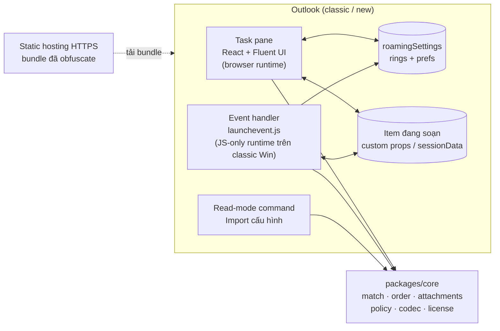
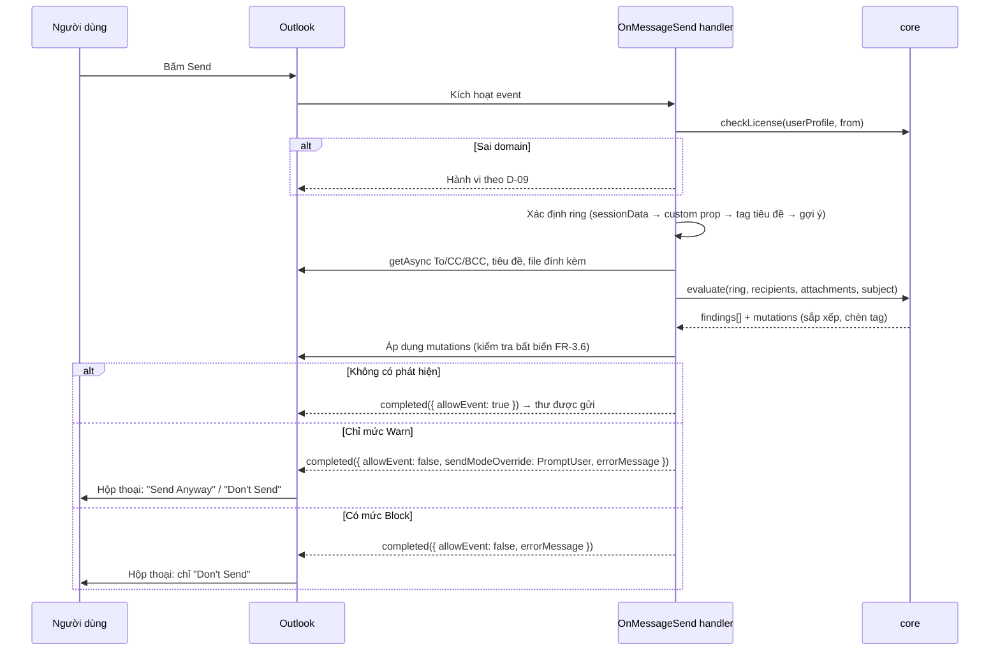

# Secure Mail Ring — Kế hoạch dự án

| Thuộc tính | Giá trị |
|---|---|
| Phiên bản tài liệu | **v0.1 — Bản nháp chờ duyệt** |
| Ngày | 2026-10-29 |
| Chủ sở hữu | Product Owner (người yêu cầu) |
| Trạng thái | Chờ trả lời các quyết định mở ở **§12** trước khi khóa phạm vi (Stage 0 gate) |
| Quy ước | `FR-x.y` = yêu cầu chức năng · `NFR-x` = phi chức năng · `D-xx` = quyết định cần duyệt · `R-xx` = rủi ro · **[Verify-S0]** = giả định kỹ thuật phải được kiểm chứng ở Stage 0 trước khi xây dựng tiếp |

> Nguyên tắc làm việc: mỗi stage đi theo chuỗi **Scope → Draft → Validate/Test → Sign-off → Package**. Không stage nào bắt đầu khi gate của stage trước chưa được ký duyệt. Mọi thông số API Office.js trong tài liệu này được ghi theo hiểu biết hiện tại và **phải xác minh trên đúng build Outlook của người dùng** ở Stage 0 — không xây trên giả định chưa kiểm chứng.

---

## 1. Tóm tắt điều hành

**Vấn đề.** Gửi nhầm người nhận (autocomplete, reply-all, forward) và đính kèm nhầm file của khách hàng/dự án khác là nguồn rò rỉ dữ liệu phổ biến nhất trong môi trường tư vấn – kiểm toán. Outlook không có kiểm soát gốc theo "nhóm giao dịch" (engagement).

**Giải pháp.** Một Outlook add-in kiểm soát **tại thời điểm bấm Send** (preventive, automated control) dựa trên khái niệm **Mail Ring** — một hồ sơ cấu hình cho từng engagement gồm: danh sách người nhận hợp lệ (địa chỉ cụ thể và/hoặc domain), tag tiêu đề, quy tắc sắp xếp To/CC/BCC, và ký hiệu bắt buộc trên tên file đính kèm. Cấu hình có thể chia sẻ nội bộ qua một token/link mã hóa; add-in chỉ hoạt động với domain được nhúng khi build.

**Khuyến nghị nền tảng.** **Office Web Add-in (Office.js) + Smart Alerts (`OnMessageSend`)**, viết bằng TypeScript. Đây là công nghệ duy nhất chạy được trên cả *classic Outlook for Windows* và *new Outlook for Windows* (new Outlook **không** hỗ trợ COM/VSTO). Chi tiết so sánh tại §4.

**Ước lượng sơ bộ.** 8 stage (S0–S7), khoảng **36–55 ngày công** cho 1 developer, tùy kết quả Stage 0 và các quyết định ở §12. Chi phí công cụ: **0 đồng** (toàn bộ công cụ miễn phí/mã nguồn mở; hosting dùng free tier).

**Ba điểm cần nói thẳng ngay từ đầu:**

1. **Loại tài khoản mail quyết định tính khả thi.** Outlook add-in chỉ chạy với hộp thư Exchange Online / Microsoft 365 (và một số trường hợp Exchange on-prem). Nếu `tunt.pro` dùng Google Workspace/IMAP trong classic Outlook, add-in sẽ **không tải** — phải đổi hướng kiến trúc. Đây là câu hỏi D-01, chặn mọi việc khác.
2. **Code add-in là JavaScript chạy ở client, được tải từ URL công khai.** Obfuscation miễn phí chỉ *tăng chi phí* dịch ngược, không *ngăn* được. Kiểm soát mạnh thực sự cho yêu cầu số 5 là **triển khai tập trung theo tenant + xác thực tenant bằng token Entra ID** (§6). Tài liệu đề xuất 3 tầng để chọn.
3. **Kiểm tra theo tên file là kiểm soát có giới hạn thiết kế.** Nó bắt được "file của ring khác" và "file chưa gắn ký hiệu", nhưng **không** bắt được file sai nội dung mà đặt đúng tên. Giới hạn này cần được ghi nhận khi trình bày control cho người dùng cuối.

---

## 2. Mục tiêu kiểm soát & phạm vi

### 2.1 Ánh xạ tính năng → mục tiêu kiểm soát

| ID | Mục tiêu kiểm soát | Tính năng | Loại kiểm soát | Giới hạn thiết kế (ghi nhận) |
|---|---|---|---|---|
| CO-1 | Ngăn gửi email đến người ngoài nhóm được phép của engagement | F1 — Mail Ring & kiểm tra người nhận | Preventive, automated, point-of-send | Người dùng có thể override cảnh báo mức *warn*; Distribution List không được bung thành viên |
| CO-2 | Ngăn đính kèm file của engagement khác | F4 — Ký hiệu tên file | Preventive, automated | Chỉ kiểm tra **tên**; không kiểm tra nội dung/metadata (theo yêu cầu) |
| CO-3 | Cấu hình nhất quán giữa các thành viên nhóm | F2 — Chia sẻ cấu hình | Configuration management | Bản import là bản sao; không đồng bộ thời gian thực |
| CO-4 | Tăng khả năng tự rà soát người nhận trước khi gửi | F3 — Sắp xếp To/CC/BCC | Hỗ trợ kiểm soát (supports human review) | Chỉ đổi **thứ tự**, không chuyển người nhận giữa To/CC/BCC |
| CO-5 | Giới hạn công cụ cho tổ chức được cấp phép; hạn chế dịch ngược | F5 — Domain lock & hardening | Access restriction / anti-tamper | Kiểm tra phía client có thể bị vượt qua bởi người có kỹ năng (§6.3) |

### 2.2 Trong phạm vi

- Outlook for Windows: **classic Outlook (Microsoft 365 Apps)** và **new Outlook for Windows**.
- Soạn thư mới, Reply, Reply All, Forward, mở lại bản nháp.
- Ring quản lý cá nhân (per-mailbox), chia sẻ thủ công qua token.
- Build pipeline có nhúng domain và obfuscation.

### 2.3 Ngoài phạm vi (v1)

| Mục | Lý do |
|---|---|
| Quét nội dung/metadata file đính kèm, DLP | Theo yêu cầu; trùng chức năng Microsoft Purview |
| Outlook Mobile (iOS/Android) | Hỗ trợ event-based/Smart Alerts trên mobile hạn chế **[Verify-S0]** |
| Outlook for Mac, Outlook on the web | Về kỹ thuật gần như "miễn phí" vì cùng code base — đề xuất đưa vào test matrix mức *best effort* (D-02) |
| Đồng bộ ring tập trung qua server, quản trị ring theo tenant | Cần backend; đề xuất cho v2 (§11) |
| Hộp thư IMAP/POP | Office add-in không hỗ trợ **[Verify-S0]** |

---

## 3. Yêu cầu chi tiết

### F1 — Mail Ring và kiểm tra người nhận

**User story.** *Là người gửi, tôi chọn Mail Ring cho email đang soạn; khi bấm Send, add-in cảnh báo nếu có người nhận nằm ngoài ring.*

| ID | Yêu cầu |
|---|---|
| FR-1.1 | Tạo/sửa/xóa/nhân bản ring: tên, **tag tiêu đề** (ví dụ `[ALPHA]`), danh sách thành viên |
| FR-1.2 | Thành viên là **địa chỉ cụ thể** (`cfo@abccorp.vn`), **domain chính xác** (`abccorp.vn`) hoặc **domain kèm subdomain** (`*.abccorp.vn`) — ba loại tách biệt, không suy diễn ngầm |
| FR-1.3 | Trong cửa sổ soạn thư: chọn ring từ danh sách (task pane). Khi chọn, add-in chèn tag vào đầu tiêu đề nếu chưa có |
| FR-1.4 | Ring của email được ghi bền vào item (custom property + `sessionData`) và có thể ghi X-header `X-MailRing-Id` để truy vết |
| FR-1.5 | Reply/Forward tự nhận diện ring từ tag tiêu đề hoặc custom property của thư gốc |
| FR-1.6 | Khi Send: kiểm tra **To + CC + BCC**; liệt kê từng người ngoài ring trong thông báo Smart Alerts |
| FR-1.7 | Chính sách domain nội bộ (domain của người gửi): *allow* / *warn* / *treat as outsider* — cấu hình theo từng ring (D-07) |
| FR-1.8 | Không chọn ring: hành vi theo D-05 (đề xuất: gợi ý ring khớp nhất theo người nhận; cảnh báo nếu có người nhận ngoài domain nội bộ) |
| FR-1.9 | Cảnh báo theo thời gian thực khi đang soạn (thanh thông báo trong item) qua sự kiện thay đổi người nhận — không chặn, chỉ báo trước |

**Quy tắc nghiệp vụ & edge case**

- Chuẩn hóa địa chỉ: `trim`, lowercase, chuẩn hóa Unicode NFC, domain quốc tế chuyển **punycode** trước khi so khớp (chống homograph `аbccorp.vn` dùng chữ Cyrillic).
- `abccorp.vn` **không** khớp `mail.abccorp.vn` trừ khi khai báo `*.abccorp.vn`. `*.abccorp.vn` không khớp `abccorp.vn.attacker.com` (so khớp theo nhãn domain từ phải sang trái, không phải substring).
- Distribution List / nhóm M365: add-in chỉ thấy địa chỉ nhóm, không thấy thành viên → nhóm phải được khai báo **đích danh** trong ring; không suy ra hợp lệ từ domain (D-08).
- Người nhận chưa resolve (chỉ có display name): coi là ngoài ring.

**Acceptance criteria (mẫu):** Ring `ALPHA` = {`abccorp.vn`, `kt@partner.vn`}; email gửi To `a@abccorp.vn`, CC `kt@partner.vn`, BCC `x@gmail.com` → Smart Alert liệt kê đúng 1 người: `x@gmail.com (BCC)`.

### F2 — Chia sẻ cấu hình qua link/token mã hóa

| ID | Yêu cầu |
|---|---|
| FR-2.1 | Xuất 1 ring thành **share token** dạng `smr1.<payload>.<sig>` (JSON → nén deflate → mã hóa → base64url) |
| FR-2.2 | Token được bọc thành link `https://<host>/import#smr1...` — dữ liệu nằm sau `#` nên **không bao giờ gửi lên server** |
| FR-2.3 | Sau khi lưu ring, tùy chọn "Chia sẻ cho đồng nghiệp": add-in mở một email mới (`displayNewMessageForm`) điền sẵn người nhận là **các địa chỉ cụ thể thuộc domain nội bộ** trong ring, nội dung chứa link + hướng dẫn. Người dùng xem lại rồi tự bấm Send |
| FR-2.4 | **Chặn chia sẻ ra ngoài domain nội bộ** — cấu hình ring chính là danh sách khách hàng, bản thân nó là thông tin mật |
| FR-2.5 | Import một chạm: người nhận mở email chia sẻ trong Outlook → bấm nút add-in (read mode) → add-in tự tìm token trong thân thư → hiển thị **bản xem trước + diff** → bấm *Import* |
| FR-2.6 | Import thủ công: dán link/token vào ô Import trong Settings |
| FR-2.7 | Kiểm tra nguồn trước khi import: người gửi thuộc domain được phép **và** header `Authentication-Results` cho thấy DKIM/DMARC pass cho domain đó (chống giả mạo) |
| FR-2.8 | Phiên bản hóa: mỗi ring có `id` + `rev`. Import trùng `id` với `rev` mới hơn → cập nhật sau khi xem diff; `rev` cũ hơn → từ chối, báo rõ |

**Vì sao không dùng "bấm link là tự import" thuần túy.** Web add-in không đăng ký được URL protocol handler; trang web mở trong trình duyệt **không có quyền ghi** vào bộ nhớ của add-in trong Outlook. Vì vậy luồng "một chạm" thực tế là *bấm nút add-in trên chính email chia sẻ*. Link HTTPS vẫn hữu ích: trang `/import` hiển thị hướng dẫn và nút "Copy token" cho trường hợp người dùng mở link ngoài Outlook. Phương án "link tự import hoàn toàn" chỉ khả thi khi có backend lưu cấu hình (v2, §11).

### F3 — Sắp xếp người nhận To/CC/BCC

| ID | Yêu cầu |
|---|---|
| FR-3.1 | Mỗi ring có 3 danh sách thứ tự (To, CC, BCC); mỗi phần tử là địa chỉ cụ thể hoặc domain, **trộn lẫn tùy ý**, kéo-thả để sắp xếp |
| FR-3.2 | Quy tắc xếp hạng: người nhận lấy hạng = vị trí của **mẫu đầu tiên khớp** trong danh sách (WYSIWYG — đọc từ trên xuống) |
| FR-3.3 | Người nhận không khớp mẫu nào: xếp sau cùng, **giữ nguyên thứ tự gốc** (stable sort); có thể đặt mẫu `*` để chỉ định vị trí của nhóm "còn lại" |
| FR-3.4 | UI cảnh báo **mẫu bị che khuất**: ví dụ `abccorp.vn` đứng trước `cfo@abccorp.vn` thì mẫu sau không bao giờ được dùng (cùng bài học "longest/most-specific match" đã gặp ở dự án CPE) |
| FR-3.5 | Thời điểm sắp xếp: khi Send (tự động) + nút "Sắp xếp ngay" trong task pane để người dùng thấy kết quả trước (D-06) |
| FR-3.6 | **Bất biến an toàn:** tập người nhận (multiset địa chỉ + display name + trường To/CC/BCC) trước và sau khi sắp xếp phải giống hệt. Nếu khác hoặc `setAsync` lỗi → hủy sắp xếp, giữ nguyên, ghi log; **không bao giờ chặn gửi chỉ vì lỗi sắp xếp** |

### F4 — Ký hiệu bắt buộc trên tên file đính kèm

| ID | Yêu cầu |
|---|---|
| FR-4.1 | Mỗi ring có tập **token** cho tên file (ví dụ `ALPHA`, `ABC-IA`) |
| FR-4.2 | Khi Send: mỗi file đính kèm (không phải inline) phải chứa **ít nhất một** token của ring hiện tại (chế độ *any*; chế độ *all*/regex để mở rộng sau) |
| FR-4.3 | **Kiểm tra chéo ring:** tên file chứa token của **ring khác** (mà không chứa token của ring hiện tại) → mức nghiêm trọng cao nhất. Đây là tín hiệu gửi nhầm mạnh nhất |
| FR-4.4 | So khớp token **theo ranh giới** (boundary-aware), không phải substring: `ABC` không khớp `ABCD_Report.xlsx`. Ranh giới = đầu/cuối chuỗi hoặc ký tự không phải chữ-số (`_ - . [ ] ( ) space`) |
| FR-4.5 | Không phân biệt hoa thường; chuẩn hóa NFC; tùy chọn bỏ dấu tiếng Việt khi so khớp |
| FR-4.6 | Ngoại lệ cấu hình được: ảnh inline (chữ ký), phần mở rộng `.ics`, `.vcf` |
| FR-4.7 | Loại đính kèm: file thường, item đính kèm (`.msg` — tên = tiêu đề thư), cloud attachment (OneDrive/SharePoint link) — đều kiểm tra theo tên |
| FR-4.8 | Chỉ đọc **tên** qua `getAttachmentsAsync`; không đọc nội dung (đúng yêu cầu, đồng thời giảm quyền cần cấp) |

**Ma trận mức độ đề xuất**

| Phát hiện | Mức mặc định | Người dùng override được? |
|---|---|---|
| Người nhận ngoài ring | Warn | Có ("Send Anyway") |
| File thiếu token của ring | Warn | Có |
| File mang token của ring khác | **Block** | Không — phải gỡ file hoặc đổi tên |
| Thiếu tag tiêu đề | Tự sửa (chèn tag) | — |

Mức cụ thể chờ duyệt ở D-04.

### F5 — Domain lock khi build & tăng cường chống dịch ngược

| ID | Yêu cầu |
|---|---|
| FR-5.1 | Danh sách domain được phép (`ALLOWED_SENDER_DOMAINS`) được **nhúng lúc build** từ biến môi trường/secret CI, không nằm trong repo |
| FR-5.2 | Runtime kiểm tra domain của `userProfile.emailAddress` **và** của trường `From` trong thư đang soạn (bắt trường hợp gửi từ shared mailbox/delegate) |
| FR-5.3 | Sai domain → task pane hiển thị màn hình từ chối ("Add-in không được cấp phép cho hộp thư này"); handler Send xử lý theo D-09 |
| FR-5.4 | Pipeline hardening miễn phí: minify, obfuscation, khóa origin hosting, tắt source map production, CSP (chi tiết §6.4) |
| FR-5.5 | (Tùy chọn Tầng 3) Xác thực tenant bằng token Entra ID qua backend free tier — §6.3 |

### Yêu cầu phi chức năng

| ID | Yêu cầu |
|---|---|
| NFR-1 | Kiểm tra khi Send hoàn tất < 1,5 giây cho email ≤ 50 người nhận, ≤ 20 file (đo ở Stage 4) |
| NFR-2 | Fail-safe: lỗi nội bộ của add-in **không được** làm mất email hoặc treo Outlook; hành vi khi add-in không tải được do manifest quyết định (SoftBlock — §5.4) |
| NFR-3 | Không gửi dữ liệu email ra ngoài Outlook (trừ Tầng 3 nếu chọn: chỉ gửi token định danh, không gửi nội dung) |
| NFR-4 | Quyền tối thiểu trong manifest: `ReadWriteItem` (không xin `ReadWriteMailbox`) |
| NFR-5 | Song ngữ UI Việt/Anh (i18n từ đầu, chi phí thấp nếu làm sớm) |
| NFR-6 | Core logic là module thuần TypeScript, không phụ thuộc Office.js, độ phủ unit test ≥ 90% |

---

## 4. Nền tảng công nghệ

### 4.1 So sánh phương án

| Tiêu chí | **Office Web Add-in (Office.js)** ✅ | VSTO (C#/.NET Framework) | COM add-in (C++/C#) |
|---|---|---|---|
| Classic Outlook for Windows | Có (Microsoft 365 Apps, build đủ mới) | Có | Có |
| **New Outlook for Windows** | **Có** | **Không** | **Không** |
| OWA / Mac | Có (cùng code) | Không | Không |
| Chặn/cảnh báo khi Send | Smart Alerts `OnMessageSend` | `Application.ItemSend` (rất mạnh) | `ItemSend` |
| Sắp xếp người nhận | `to/cc/bcc.setAsync` **[Verify-S0 trong ngữ cảnh OnMessageSend]** | Toàn quyền object model | Toàn quyền |
| Đọc tên file đính kèm | `getAttachmentsAsync` | Có | Có |
| Triển khai | Manifest + hosting HTTPS; admin center hoặc sideload | MSI/ClickOnce, cần cài đặt trên máy | Đăng ký registry, cài đặt máy |
| Chống dịch ngược (công cụ miễn phí) | Yếu (JS) — obfuscator | Trung bình (.NET IL dễ decompile; ConfuserEx miễn phí nhưng đã ngừng phát triển) | Tốt nhất (native) |
| Hướng đi của Microsoft | **Chiến lược chính thức** | Duy trì, không phát triển; không có tương lai trên new Outlook | Như VSTO |

**Khuyến nghị: Office Web Add-in.** VSTO cho kiểm soát mạnh hơn trên classic Outlook nhưng là ngõ cụt khi tổ chức chuyển sang new Outlook — một kiểm soát mất hiệu lực khi người dùng bật công tắc "Try the new Outlook" là thiết kế không bền vững. Đổi lại, ta chấp nhận khả năng chống dịch ngược yếu hơn và bù bằng kiểm soát triển khai (§6).

### 4.2 Stack đề xuất

| Lớp | Lựa chọn | Lý do |
|---|---|---|
| Ngôn ngữ | TypeScript (strict) | An toàn kiểu cho rule engine |
| Scaffold | Yeoman `generator-office` (Outlook, TypeScript) | Công cụ chính thức, miễn phí |
| Manifest | **XML add-in-only manifest** (giai đoạn 1); lộ trình sang unified JSON manifest | XML tương thích rộng nhất với classic Outlook và sideload **[Verify-S0]** |
| Bundler | webpack (mặc định của template) | Tích hợp `webpack-obfuscator` |
| UI task pane | React 18 + **Fluent UI React v9** | Giao diện đồng bộ Outlook |
| Rule engine | Package thuần `packages/core` — không import Office.js | Test trên Node, tái sử dụng cho mọi runtime |
| Validation schema | `valibot` hoặc `zod` | Kiểm tra cấu hình import (dữ liệu không tin cậy) |
| Nén | `fflate` | Nhẹ, thuần JS, chạy được trong JS-only runtime |
| Mã hóa token | WebCrypto (AES-GCM) — chỉ trong task pane | Không phụ thuộc thư viện ngoài |
| Test | Vitest + `office-addin-mock` | Nhanh, không cần cài Outlook cho unit test |
| Lint | ESLint + `eslint-plugin-office-addins` + Prettier | Bắt lỗi API Office phổ biến |
| Obfuscation | `javascript-obfuscator` (qua `webpack-obfuscator`) | Miễn phí, mã nguồn mở |
| Hosting | Cloudflare Pages / GitHub Pages / Azure Static Web Apps (free tier) | Chỉ cần HTTPS tĩnh (D-03) |
| CI/CD | GitHub Actions | Lint → test → build → obfuscate → validate manifest → deploy |
| Debug | `office-addin-debugging`, Edge DevTools (WebView2), runtime logging của event-based add-in trên Windows | |

### 4.3 Ánh xạ tính năng → API Office.js

Requirement set ghi theo tài liệu Microsoft hiện hành — **toàn bộ cột này là [Verify-S0]**.

| Tính năng | API | Requirement set |
|---|---|---|
| Chặn/cảnh báo khi Send | Event `OnMessageSend` (Smart Alerts), `event.completed({ allowEvent, errorMessage })` | Mailbox 1.12 |
| Tùy biến nút/ chế độ override theo từng lần | `sendModeOverride`, `cancelLabel`, `commandId` | Mailbox 1.14 |
| Thông báo dạng Markdown | `errorMessageMarkdown` | Mailbox 1.15 |
| Cảnh báo khi đang soạn | Events `OnMessageRecipientsChanged`, `OnMessageAttachmentsChanged`; `item.notificationMessages` | Mailbox 1.11 |
| Tự gán ring cho Reply/Forward | Event `OnNewMessageCompose` | Mailbox 1.10 |
| Đọc/ghi người nhận | `item.to / cc / bcc` `getAsync` / `setAsync` | Mailbox 1.1 |
| Đọc/ghi tiêu đề | `item.subject` `getAsync` / `setAsync` | Mailbox 1.1 |
| Tên file đính kèm (compose) | `item.getAttachmentsAsync` | Mailbox 1.8 |
| Lưu ring đã chọn vào item | `loadCustomPropertiesAsync`; `item.sessionData` | 1.1; 1.11 |
| X-header truy vết | `item.internetHeaders.setAsync` | Mailbox 1.8 |
| Người gửi | `mailbox.userProfile.emailAddress`; `item.from.getAsync` | 1.1; 1.7 |
| Lưu cấu hình ring | `Office.context.roamingSettings` (giới hạn ~32 KB, đồng bộ theo hộp thư) | Mailbox 1.1 |
| Mở email chia sẻ cấu hình | `mailbox.displayNewMessageForm` | Mailbox 1.6 |
| Đọc token & header xác thực (read mode) | `item.body.getAsync`; `item.getAllInternetHeadersAsync` | 1.3; 1.8 |

---

## 5. Kiến trúc

### 5.1 Thành phần



**Ràng buộc kiến trúc quan trọng:** trên classic Outlook for Windows, event handler chạy trong **JavaScript-only runtime** — không có DOM, không có React, tập API hạn chế. Vì vậy:

- `launchevent.js` là một bundle **riêng**, chỉ import `packages/core` + `fflate`; không import UI.
- Event handler **không** cần giải mã AES: cấu hình trong `roamingSettings` được lưu ở dạng đã giải mã (chỉ nén), vì nó đã nằm trong chính hộp thư của người dùng. Mã hóa chỉ áp dụng cho token chia sẻ (đi qua email).

### 5.2 Luồng khi bấm Send



### 5.3 Mô hình dữ liệu

```jsonc
{
  "schema": "smr/1",
  "id": "01JBX4Q8...",            // ULID, bất biến
  "rev": 3,                        // tăng mỗi lần sửa
  "name": "Alpha – IA ABC Corp FY26",
  "subjectTag": "[ALPHA]",
  "owner": "tunt@tunt.pro",
  "updatedAt": "2026-10-29T08:00:00Z",
  "members": [
    { "kind": "address", "value": "cfo@abccorp.vn" },
    { "kind": "domain",  "value": "abccorp.vn" },
    { "kind": "subdomains", "value": "abccorp.vn" }     // = *.abccorp.vn
  ],
  "internalDomain": "allow",                            // allow | warn | outsider
  "order": {
    "to":  ["cfo@abccorp.vn", "abccorp.vn", "*"],
    "cc":  ["partner@tunt.pro", "tunt.pro", "*"],
    "bcc": []
  },
  "attachments": {
    "tokens": ["ALPHA", "ABC-IA"],
    "mode": "any",
    "ignoreInline": true,
    "exemptExtensions": [".ics", ".vcf"]
  },
  "policy": {
    "outsider": "warn",
    "missingToken": "warn",
    "foreignRingToken": "block"
  }
}
```

### 5.4 Chiến lược lưu trữ và hành vi khi lỗi

| Dữ liệu | Nơi lưu | Ghi chú |
|---|---|---|
| Danh sách ring + tùy chọn | `roamingSettings`, nén `fflate` | ~32 KB/add-in/hộp thư ≈ 30–60 ring sau nén **[Verify-S0 dung lượng thực]**. Vượt ngưỡng → D-10 |
| Ring của email đang soạn | `sessionData` (chia sẻ task pane ↔ handler) + custom property (bền khi lưu nháp) | |
| Truy vết sau khi gửi | X-header `X-MailRing-Id: <id>/<rev>` | Tùy chọn; header đi kèm thư ra ngoài — cân nhắc lộ tên mã (D-11) |
| Sao lưu | Xuất toàn bộ ring thành token tự gửi cho chính mình | Không cần quyền file system |

**Chế độ gửi trong manifest: `SoftBlock`.** Nếu add-in không tải được (hosting lỗi, mất mạng), Outlook vẫn cho gửi — tránh việc sự cố hạ tầng làm tê liệt email. `Block` cứng chỉ hợp lý khi triển khai tập trung và chấp nhận rủi ro gián đoạn (D-04). **[Verify-S0]** hành vi Smart Alerts khi classic Outlook ở chế độ offline/cached.

### 5.5 Định dạng share token

```
smr1.<base64url( AES-GCM( deflate( JSON ring ) ) )>.<keyId>
```

- Khóa AES dẫn xuất (PBKDF2/HKDF) từ **org secret nhúng lúc build** → chỉ add-in build cho đúng tổ chức mới đọc được token.
- AES-GCM đã bao gồm toàn vẹn (tag xác thực) — token bị sửa sẽ bị từ chối.
- **Ghi nhận thẳng:** khóa nằm trong bundle client nên đây là *obfuscation có cấu trúc*, không phải bảo mật chống người nội bộ có add-in. Neo tin cậy thực sự cho import là **FR-2.7** (domain người gửi + DKIM/DMARC pass) và **bản xem trước/diff** trước khi người dùng xác nhận.
- Giới hạn độ dài: link trong thân email không có giới hạn thực tế đáng kể; với ring rất lớn token có thể dài vài KB — chấp nhận được.

---

## 6. Bảo mật, mô hình đe dọa và hardening

### 6.1 Mô hình đe dọa

| ID | Mối đe dọa | Kịch bản | Kiểm soát |
|---|---|---|---|
| T-1 | Import cấu hình độc hại | Kẻ tấn công gửi token whitelist domain của hắn vào ring `ALPHA` | FR-2.7 (domain + DKIM/DMARC), diff preview, `rev` monotonic, chặn import từ ngoài domain |
| T-2 | Domain lookalike | `abccorp.vn` vs `abcc0rp.vn`, homograph Cyrillic | Chuẩn hóa punycode; (tùy chọn) cảnh báo domain gần giống domain trong ring — §11 |
| T-3 | Phân phối lại add-in cho tổ chức khác | Copy manifest + bundle sang host khác, sửa chuỗi domain | Obfuscation + `domainLock` theo origin hosting + Tầng 3 |
| T-4 | Vượt kiểm tra domain phía client | Người dùng sửa JS/patch runtime | Chấp nhận ở Tầng 1–2; Tầng 3 dùng xác thực phía server |
| T-5 | Override thành thói quen | Cảnh báo quá nhiều → người dùng luôn bấm "Send Anyway" (control erosion) | Thiết kế mức độ cẩn trọng; đo tỷ lệ false positive ở UAT; mức Block chỉ cho tín hiệu mạnh |
| T-6 | Sắp xếp làm mất người nhận | `setAsync` lỗi giữa chừng | Bất biến FR-3.6, rollback, không chặn gửi |
| T-7 | Lộ cấu hình qua X-header | Header `X-MailRing-Id` đi ra ngoài | Chỉ ghi ID ngẫu nhiên (ULID), không ghi tên ring (D-11) |
| T-8 | Chuỗi cung ứng phụ thuộc npm | Package độc hại | Lockfile, `npm audit`, ghim version, Dependabot, tối thiểu dependency trong bundle event |

### 6.2 Domain lock — cơ chế

1. CI đọc secret `ALLOWED_SENDER_DOMAINS` (và `ORG_TOKEN_SECRET`) → webpack `DefinePlugin` nhúng vào bundle.
2. Danh sách được lưu dưới dạng **hash (SHA-256 có salt)** thay vì chuỗi rõ, so khớp bằng hash của domain người dùng → không thể đọc domain bằng `strings`/tìm kiếm văn bản.
3. Kiểm tra được **rải ở nhiều điểm** (task pane khởi động, mỗi event, trước khi xuất/nhập token) thay vì một hàm `isLicensed()` duy nhất dễ patch.
4. Kết quả kiểm tra tham gia vào luồng dữ liệu (ví dụ: tham gia dẫn xuất khóa giải mã cấu hình chia sẻ) thay vì chỉ là một nhánh `if` → patch bỏ nhánh `if` không đủ để add-in chạy đúng.

### 6.3 Ba tầng bảo vệ — chọn ở D-12

| Tầng | Nội dung | Chi phí | Chống được | Không chống được |
|---|---|---|---|---|
| **1. Cơ bản** | Kiểm tra domain nhúng + minify + obfuscation | 0 đồng, ~1 ngày | Người dùng phổ thông, copy đơn giản | Người có kỹ năng JS, có thời gian |
| **2. Tăng cường** (đề xuất) | Tầng 1 + hash domain, rải kiểm tra, `domainLock` theo origin hosting, self-defending, string-array encryption, CSP, không source map, triển khai **chỉ qua admin center của tenant** | 0 đồng, ~3–4 ngày | Phân phối lại sang host/tổ chức khác; dịch ngược "lướt" | Reverse engineer có chủ đích |
| **3. Xác thực tenant** | Tầng 2 + SSO Entra ID (Nested App Authentication/MSAL) → backend free tier (Cloudflare Worker) xác minh chữ ký JWT và `tid` = tenant ID được phép → cấp "license token" ngắn hạn cần cho các chức năng chính | 0 đồng (free tier), ~4–6 ngày; cần đăng ký app trong Entra ID (quyền admin) | Gần như mọi kịch bản dùng trái phép ngoài tenant — kiểm tra không còn nằm ở client | Người dùng hợp lệ trong tenant tự sửa code của chính họ |

**Lưu ý hosting (bài học từ dự án CPE dùng Cloudflare Access):** *không* thể đặt Cloudflare Access/đăng nhập tương tác trước bundle add-in — JS-only runtime tải `launchevent.js` mà không có phiên đăng nhập. Bundle add-in **luôn công khai**; đó chính là lý do Tầng 1–2 chỉ là tăng chi phí, còn Tầng 3 là kiểm soát thực.

### 6.4 Pipeline hardening miễn phí

| Bước | Công cụ | Cấu hình chính | Cảnh báo |
|---|---|---|---|
| Minify | Terser (webpack mặc định) | `drop_console` ở production | |
| Obfuscate | `javascript-obfuscator` / `webpack-obfuscator` | `stringArray` + `stringArrayEncoding: ['rc4']`, `controlFlowFlattening` (ngưỡng thấp), `selfDefending`, `identifierNamesGenerator: 'hexadecimal'`, `domainLock: ['<host>']` | `deadCodeInjection`, `debugProtection` và control-flow flattening mức cao có thể **làm chậm hoặc hỏng JS-only runtime** → bật từng tùy chọn và đo NFR-1 ở Stage 6 |
| Source map | Tắt ở production | Giữ source map nội bộ (artifact CI riêng tư) để debug | |
| Toàn vẹn | CSP header, HSTS trên hosting; SRI cho script task pane | | SRI không áp dụng được cho file do Outlook tải trực tiếp **[Verify-S0]** |
| Bí mật | GitHub Actions secrets | Domain/secret không bao giờ nằm trong repo | Repo nên để **private** |
| Kiểm tra sau build | Script grep bundle | Fail build nếu tìm thấy domain rõ, secret rõ, `sourceMappingURL` | |

---

## 7. Các giai đoạn phát triển

Effort tính theo ngày công của 1 developer, mang tính chỉ báo; sẽ hiệu chỉnh sau Stage 0.

| Stage | Tên | Effort | Phụ thuộc | Gate |
|---|---|---|---|---|
| S0 | Discovery & Technical spike | 3–5 | — | **Go/No-go nền tảng** |
| S1 | Core rule engine | 5–8 | S0 | Unit test xanh, ≥ 90% coverage |
| S2 | Add-in shell & quản lý ring | 5–7 | S1 | Sideload chạy trên 2 client |
| S3 | Tích hợp soạn thư | 4–6 | S2 | Chọn ring/tag/reply ổn định |
| S4 | On-send guard (Smart Alerts) | 6–10 | S3 | F1, F3, F4 đạt acceptance |
| S5 | Chia sẻ cấu hình | 5–7 | S2 | F2 đạt acceptance, test giả mạo |
| S6 | Domain lock & hardening | 4–6 | S4 | Bundle obfuscate vẫn đạt NFR-1 |
| S7 | UAT, đóng gói, triển khai | 4–6 | S4–S6 | Sign-off phát hành v1.0 |
| | **Tổng** | **36–55** | | |

### Stage 0 — Discovery & Technical spike

**Mục tiêu:** biến mọi **[Verify-S0]** thành sự thật đã kiểm chứng trước khi viết code sản phẩm.

| Việc | Đầu ra |
|---|---|
| Chốt các quyết định D-01 → D-12 (§12) | Decision log đã ký |
| Ghi nhận môi trường: loại hộp thư, kênh cập nhật Microsoft 365 Apps, build Outlook, có dùng new Outlook không, ai có quyền admin tenant | Bảng môi trường |
| Spike 1: add-in "hello" `OnMessageSend` chạy trên classic + new Outlook; kiểm tra `sendModeOverride`, `errorMessageMarkdown` | Ảnh chụp + requirement set thực tế (`Office.context.requirements.isSetSupported`) |
| Spike 2: `to/cc/bcc.setAsync` **bên trong** `OnMessageSend` — có được phép không, có giữ display name không, có làm resolve lại người nhận không | Kết luận + phương án dự phòng (sắp xếp qua task pane) |
| Spike 3: `roamingSettings` truy cập được trong JS-only runtime; đo dung lượng thực sau nén | Số ring tối đa |
| Spike 4: hành vi khi offline, khi hosting trả 404, khi handler ném lỗi | Bảng fail-mode |
| Spike 5: bundle đã qua `javascript-obfuscator` chạy được trong JS-only runtime | Danh sách tùy chọn obfuscator an toàn |
| Dựng repo, CI rỗng, hosting dev | Skeleton repo |

**Gate (Go/No-go):** nếu D-01 cho thấy hộp thư không phải Exchange/M365, hoặc Spike 1 thất bại trên build hiện tại → dừng và trình phương án thay thế (VSTO chỉ cho classic Outlook, hoặc nâng cấp kênh cập nhật Office) trước khi đi tiếp.

### Stage 1 — Core rule engine (`packages/core`)

| Module | Trách nhiệm |
|---|---|
| `model` | Kiểu dữ liệu, schema `smr/1`, validate + migrate schema |
| `normalize` | Chuẩn hóa email/domain (lowercase, NFC, punycode), tách nhãn domain |
| `match` | So khớp người nhận với thành viên ring (address/domain/subdomains) |
| `order` | Xếp hạng first-match-wins, stable sort, phát hiện mẫu bị che khuất, kiểm tra bất biến |
| `attachments` | Token boundary-aware, kiểm tra chéo ring, ngoại lệ |
| `policy` | Gộp phát hiện → mức Warn/Block → thông điệp (Việt/Anh, ≤ giới hạn ký tự Smart Alerts) |
| `codec` | Encode/decode share token, nén, kiểm tra kích thước |
| `license` | So khớp domain dạng hash |

**Bộ test bắt buộc (trích):** `abccorp.vn` ≠ `mail.abccorp.vn`; `*.abccorp.vn` ≠ `abccorp.vn.evil.com`; `ABC` không khớp `ABCD_x.pdf` nhưng khớp `x_ABC.pdf`, `[ABC] x.pdf`; homograph Cyrillic bị phát hiện; sắp xếp không làm mất/nhân bản người nhận (property-based test với dữ liệu ngẫu nhiên); token bị sửa 1 byte → decode thất bại.

**Gate:** toàn bộ test xanh, coverage ≥ 90%, review code.

### Stage 2 — Add-in shell & quản lý ring

- Scaffold bằng `yo office`, manifest XML, 2 entry point: task pane (React) và `launchevent` (JS thuần).
- Màn hình: danh sách ring, form tạo/sửa (thành viên, tag, thứ tự kéo-thả 3 cột, token file, chính sách), cảnh báo mẫu bị che khuất, nhân bản ring, xóa có xác nhận.
- Lớp lưu trữ `roamingSettings` có nén, kiểm tra quota, báo lỗi rõ khi gần đầy.
- i18n Việt/Anh.

**Gate:** sideload thành công trên classic + new Outlook; CRUD ring đồng bộ giữa 2 client của cùng hộp thư.

### Stage 3 — Tích hợp soạn thư

- Bộ chọn ring trong task pane compose; chèn/thay tag tiêu đề (không chèn trùng, xử lý `RE:`/`FW:`/`TL:`).
- Lưu ring vào `sessionData` + custom property; `OnNewMessageCompose` gán ring tự động cho Reply/Forward.
- `OnMessageRecipientsChanged` / `OnMessageAttachmentsChanged` → thanh thông báo trước khi Send (không chặn).
- Nút "Sắp xếp ngay".

**Gate:** kịch bản Reply/Reply All/Forward/mở lại nháp giữ đúng ring trên cả 2 client.

### Stage 4 — On-send guard (Smart Alerts)

- Handler `OnMessageSend` theo §5.2; quy tắc xác định ring theo thứ tự ưu tiên.
- Thông điệp ngắn gọn, liệt kê đích danh người nhận/file vi phạm, mỗi dòng một vấn đề.
- Áp dụng sắp xếp + chèn tag với kiểm tra bất biến và rollback.
- Đo hiệu năng NFR-1; xử lý timeout an toàn.

**Gate:** đạt toàn bộ acceptance F1, F3, F4 trong test matrix §8; không có kịch bản nào làm mất email.

### Stage 5 — Chia sẻ cấu hình

- Export token, tạo email chia sẻ (`displayNewMessageForm`), chặn người nhận ngoài domain.
- Read-mode command: dò token trong thân thư, kiểm tra người gửi + `Authentication-Results`, diff preview, import/cập nhật theo `rev`.
- Trang `/import` tĩnh: hướng dẫn + nút copy token (không gửi gì lên server).

**Gate:** test âm tính — token bị sửa, token từ domain ngoài, email giả mạo DKIM fail, `rev` cũ hơn — đều bị từ chối với thông điệp rõ ràng.

### Stage 6 — Domain lock & hardening

- Nhúng domain dạng hash qua CI secret; rải kiểm tra; tích hợp khóa token với kết quả license.
- Cấu hình obfuscator theo kết quả Spike 5; đo lại NFR-1 trên bundle đã obfuscate.
- Script kiểm tra hậu build (không có domain rõ/secret/source map).
- (Nếu chọn Tầng 3) Entra ID app registration, NAA/MSAL, Cloudflare Worker xác minh JWT.

**Gate:** build cho domain A từ chối hộp thư domain B; bundle production vượt qua script kiểm tra; hiệu năng vẫn đạt NFR-1.

### Stage 7 — UAT, đóng gói, triển khai

- UAT với 3–5 người dùng thật trong 1–2 tuần; đo **tỷ lệ false positive và tỷ lệ override** (chỉ báo control erosion).
- Tài liệu: hướng dẫn người dùng (Việt), hướng dẫn quản trị/triển khai (Anh), mô tả kiểm soát & giới hạn (Anh — dùng được cho hồ sơ kiểm soát nội bộ).
- Phát hành: build production → hosting → manifest production → triển khai qua Microsoft 365 admin center (Integrated Apps) hoặc sideload (D-03).
- Quy trình cập nhật & rollback: bundle có version, giữ bản trước trên hosting để quay lui trong vài phút.

**Gate:** sign-off phát hành v1.0.

---

## 8. Chiến lược kiểm thử

### 8.1 Kim tự tháp kiểm thử

| Tầng | Phạm vi | Công cụ | Chạy khi |
|---|---|---|---|
| Unit | `packages/core` — toàn bộ quy tắc | Vitest (+ property-based với `fast-check`) | Mỗi commit (CI) |
| Component | Handler & task pane với Office.js giả lập | `office-addin-mock` | Mỗi commit |
| Integration thủ công | Outlook thật, theo ma trận 8.2 | Checklist có bằng chứng (ảnh chụp) | Cuối S3, S4, S5, S6 |
| UAT | Người dùng thật, email thật | Nhật ký phản hồi | S7 |

### 8.2 Ma trận kiểm thử tích hợp

| Kịch bản | Classic Outlook (M365, Current Channel) | New Outlook for Windows | OWA (best effort) |
|---|---|---|---|
| Thư mới, người nhận đều trong ring | | | |
| Có người ngoài ring ở BCC | | | |
| Reply All kéo thêm người ngoài ring | | | |
| Forward thư có đính kèm của ring khác | | | |
| File thiếu token / mang token ring khác / inline image | | | |
| Đính kèm `.msg` và cloud attachment | | | |
| Gửi từ shared mailbox / delegate | | | |
| Distribution List | | | |
| Người nhận chưa resolve | | | |
| Sắp xếp với 50+ người nhận | | | |
| Mở lại nháp đã lưu | | | |
| Offline / hosting không truy cập được | | | |
| Hộp thư sai domain (domain lock) | | | |
| Import token hợp lệ / bị sửa / từ ngoài domain | | | |

---

## 9. Triển khai & vận hành

| Hạng mục | Đề xuất |
|---|---|
| Môi trường | `dev` (localhost + sideload), `staging` (hosting riêng, manifest riêng), `prod` |
| Hosting | Static HTTPS, free tier; domain riêng (ví dụ `mailring.<domain-công-ty>`) để `domainLock` có ý nghĩa |
| Phân phối manifest | Ưu tiên **Microsoft 365 admin center → Integrated Apps** (gán theo user/group, người dùng không gỡ được, cập nhật tập trung). Dự phòng: sideload từ file XML |
| Phiên bản | SemVer; version nằm trong manifest và trong bundle; hiển thị ở màn hình About |
| Cập nhật | Thay đổi code: chỉ deploy bundle (tự áp dụng). Thay đổi manifest (quyền, event mới): cần cập nhật manifest qua admin center |
| Rollback | Giữ bundle phiên bản trước trên hosting; chuyển alias trong vài phút |
| Giám sát | Không có telemetry ở v1 (NFR-3). Nếu cần nhật ký override cho mục đích kiểm toán → §11 |

### Cấu trúc repo đề xuất

```
secure-mail-ring/
├── project_plan.md
├── manifest/
│   └── manifest.template.xml        # placeholder host/version, render lúc build
├── packages/core/                    # rule engine thuần TS + test
│   └── src/{model,normalize,match,order,attachments,policy,codec,license}.ts
├── src/
│   ├── taskpane/                     # React + Fluent UI
│   ├── launchevent/launchevent.ts    # JS-only runtime, không import UI
│   ├── readmode/                     # import cấu hình
│   └── shared/                       # i18n, storage adapter
├── public/import.html                # trang hướng dẫn import (tĩnh)
├── build/
│   ├── obfuscator.config.cjs
│   └── postbuild-check.mjs           # chặn domain rõ/secret/source map
├── docs/                             # user guide (VI), admin guide (EN), control description (EN)
└── .github/workflows/ci.yml
```

---

## 10. Sổ đăng ký rủi ro

| ID | Rủi ro | Khả năng | Tác động | Biện pháp | Stage xử lý |
|---|---|---|---|---|---|
| R-01 | Hộp thư không phải Exchange/M365 → add-in không chạy | Chưa rõ | **Rất cao** | D-01; gate S0 | S0 |
| R-02 | Build Outlook (vd. Office LTSC/perpetual, kênh Semi-Annual cũ) chưa hỗ trợ Mailbox 1.12+ | Trung bình | Cao | Spike 1; khuyến nghị kênh cập nhật | S0 |
| R-03 | `setAsync` người nhận không khả dụng trong `OnMessageSend` | Trung bình | Trung bình | Dự phòng: sắp xếp qua task pane/`OnMessageRecipientsChanged` | S0 |
| R-04 | Cảnh báo sai nhiều → người dùng luôn override | Cao | Cao | Ma trận mức độ thận trọng; đo ở UAT; chỉ Block với tín hiệu mạnh | S4, S7 |
| R-05 | Hosting gián đoạn → kiểm soát tạm mất hiệu lực | Thấp | Trung bình | SoftBlock (không làm tê liệt email); hosting CDN; ghi nhận là giới hạn đã biết | S7 |
| R-06 | Import cấu hình giả mạo | Thấp | Cao | FR-2.7, diff preview, `rev` | S5 |
| R-07 | Add-in bị dịch ngược/phân phối lại | Trung bình | Thấp–Trung bình | Tầng 2/3 (§6.3) | S6 |
| R-08 | Obfuscation làm hỏng/chậm JS-only runtime | Trung bình | Cao | Spike 5; bật từng tùy chọn; đo NFR-1 | S0, S6 |
| R-09 | Vượt quota `roamingSettings` | Thấp–Trung bình | Trung bình | Nén; cảnh báo quota; D-10 | S2 |
| R-10 | Microsoft thay đổi API/manifest (XML → unified) | Trung bình | Trung bình | Tách manifest khỏi code; theo dõi changelog Office.js | Liên tục |
| R-11 | Sắp xếp làm mất/nhân bản người nhận | Thấp | **Rất cao** | Bất biến FR-3.6 + property-based test + rollback | S1, S4 |
| R-12 | Homograph/IDN qua mặt so khớp domain | Thấp | Cao | Punycode; cảnh báo lookalike (§11) | S1 |

---

## 11. Đề xuất bổ sung (chờ duyệt — không mặc định nằm trong v1)

| # | Đề xuất | Giá trị kiểm soát | Effort | Khuyến nghị |
|---|---|---|---|---|
| E-1 | **Cảnh báo domain gần giống** (Levenshtein ≤ 2, ký tự dễ nhầm `0/o`, `1/l`, `rn/m`) so với domain trong ring | Chống BEC/lookalike — rất phù hợp bối cảnh fraud | 1–2 ngày | **Nên có trong v1** |
| E-2 | **Cảnh báo "người nhận lần đầu"** — địa chỉ chưa từng xuất hiện trong ring/lịch sử | Bắt lỗi autocomplete | 1–2 ngày | Nên có |
| E-3 | Tự gợi ý ring dựa trên người nhận khi chưa chọn ring | Giảm thao tác, tăng tỷ lệ dùng | 1 ngày | Nên có (gắn với D-05) |
| E-4 | Bắt buộc trường: ví dụ partner phải luôn ở CC, khách hàng không bao giờ ở BCC | Kiểm soát "lines of accountability" trong giao tiếp | 2 ngày | v1.1 |
| E-5 | Nhật ký override (ai, khi nào, ring nào, vi phạm gì) — local hoặc gửi về backend | Detective control, bằng chứng kiểm toán | 2–5 ngày (cần backend nếu tập trung) | Cân nhắc nếu dùng cho nhóm |
| E-6 | Thư viện ring tập trung theo tenant (admin publish, người dùng subscribe) | Thay thế chia sẻ thủ công, đồng bộ thật | 8–12 ngày (backend + Graph/SSO) | v2 |
| E-7 | Gợi ý đổi tên file thiếu token (chỉ gợi ý, không tự đổi) | Giảm ma sát | 1 ngày | v1.1 |
| E-8 | Hết hạn ring (engagement kết thúc) → tự chuyển ring sang trạng thái lưu trữ | Vệ sinh cấu hình | 0,5 ngày | Nên có |

---

## 12. Quyết định cần duyệt (Decision log)

| ID | Câu hỏi | Phương án | Đề xuất mặc định | Ảnh hưởng nếu thay đổi |
|---|---|---|---|---|
| **D-01** | Hộp thư của người dùng là gì? | Exchange Online/M365 · Exchange on-prem (phiên bản?) · Google Workspace/IMAP | — (bắt buộc trả lời) | **Quyết định khả thi của toàn bộ kiến trúc** |
| **D-02** | Client trong phạm vi? | Chỉ classic · classic + new Outlook · + OWA/Mac (best effort) | Classic + new Outlook; OWA best effort | Test matrix, effort S7 |
| **D-03** | Triển khai thế nào? Ai có quyền admin tenant? | Admin center (Integrated Apps) · sideload từng máy | Admin center | Tầng bảo vệ khả dụng; quy trình cập nhật |
| **D-04** | Mức chặn mặc định | Toàn bộ Warn · ma trận §3 F4 · toàn bộ Block | Ma trận §3 F4 (Warn + Block cho token ring khác), manifest SoftBlock | Trải nghiệm & tỷ lệ override |
| D-05 | Email không chọn ring | Bỏ qua kiểm tra · cảnh báo nếu có người ngoài domain nội bộ · bắt buộc chọn ring | Gợi ý ring (E-3) + cảnh báo nếu có người ngoài domain nội bộ | Ma sát với email thường ngày |
| D-06 | Thời điểm sắp xếp người nhận | Tự động khi Send · chỉ khi bấm nút · cả hai | Cả hai | Người dùng có thấy thứ tự cuối trước khi gửi hay không |
| D-07 | Người nhận cùng domain nội bộ nhưng không có trong ring | Luôn hợp lệ · cảnh báo · coi như người ngoài | Cấu hình theo ring, mặc định *allow* | Tường lửa thông tin nội bộ (ethical wall) |
| D-08 | Distribution List | Phải khai báo đích danh · chặn mọi DL · bỏ qua | Khai báo đích danh | |
| D-09 | Sai domain (domain lock) thì handler Send làm gì? | Fail-open (cho gửi, báo "không được cấp phép") · Fail-closed (chặn gửi) | **Fail-open** — tránh add-in làm tê liệt email của người dùng ngoài phạm vi | |
| D-10 | Số ring dự kiến / người dùng | < 30 · 30–100 · > 100 | < 30 (vừa `roamingSettings`) | > 100 cần lưu trữ khác (OfficeRuntime.storage — không roaming — hoặc backend) |
| D-11 | Ghi X-header `X-MailRing-Id` ra thư gửi đi? | Có (ID ngẫu nhiên) · Không | Không ở v1 (giảm rò rỉ thông tin) | Khả năng truy vết |
| **D-12** | Tầng bảo vệ chống dịch ngược / dùng trái phép | Tầng 1 · Tầng 2 · Tầng 3 | **Tầng 2** cho v1, thiết kế sẵn chỗ cho Tầng 3 | Effort S6 (+4–6 ngày nếu Tầng 3); cần Entra ID app registration |
| D-13 | Quy mô người dùng | Cá nhân · nhóm < 20 · toàn công ty | — | Ưu tiên E-5, E-6 |
| D-14 | Ngôn ngữ UI | Việt · Anh · song ngữ | Song ngữ | Effort i18n nhỏ nếu làm từ S2 |

---

## 13. Sign-off

| Gate | Nội dung duyệt | Người duyệt | Ngày | Trạng thái |
|---|---|---|---|---|
| G0 | Kế hoạch v0.x + decision log D-01 → D-14 | Product Owner | | ⏳ Chờ |
| G0b | Kết quả Stage 0 (Go/No-go) | Product Owner | | — |
| G1 | Core engine | Product Owner | | — |
| G4 | On-send guard | Product Owner | | — |
| G7 | Phát hành v1.0 | Product Owner | | — |

---

## Phụ lục A — Thuật ngữ

| Thuật ngữ | Giải thích |
|---|---|
| Mail Ring | Hồ sơ cấu hình cho một engagement: người nhận hợp lệ, tag tiêu đề, thứ tự, token file |
| Smart Alerts | Cơ chế của Outlook cho phép add-in kiểm tra và chặn/cảnh báo khi bấm Send (`OnMessageSend`) |
| SoftBlock / Block / PromptUser | Chế độ gửi của Smart Alerts: chặn nhưng cho gửi nếu add-in lỗi / chặn cả khi add-in lỗi / cho phép "Send Anyway" |
| JS-only runtime | Môi trường chạy event handler trên classic Outlook for Windows — không có DOM |
| roamingSettings | Bộ nhớ key-value của add-in, lưu trong hộp thư, đồng bộ giữa các thiết bị |
| Requirement set | Phiên bản tập API Office.js (Mailbox 1.x) mà client hỗ trợ |
| NAA | Nested App Authentication — cơ chế SSO hiện hành cho Office add-in qua MSAL |
| Control erosion | Hiện tượng kiểm soát mất hiệu lực vì người dùng quen bỏ qua cảnh báo |
